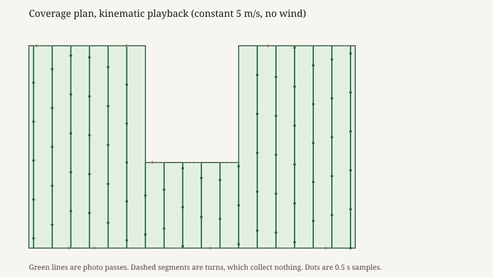
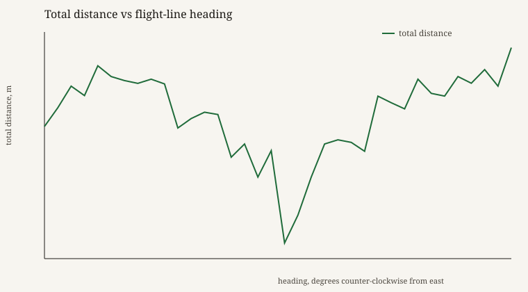
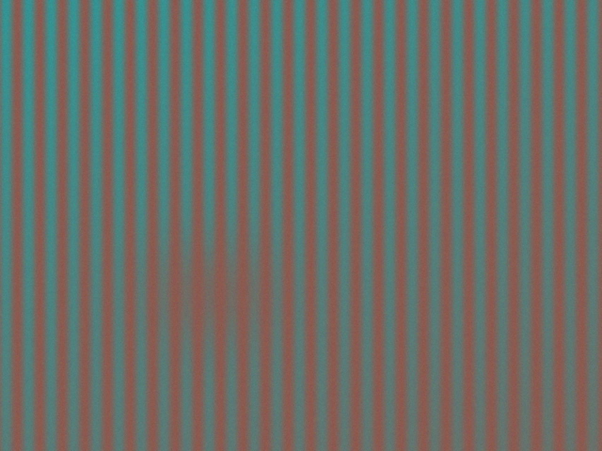
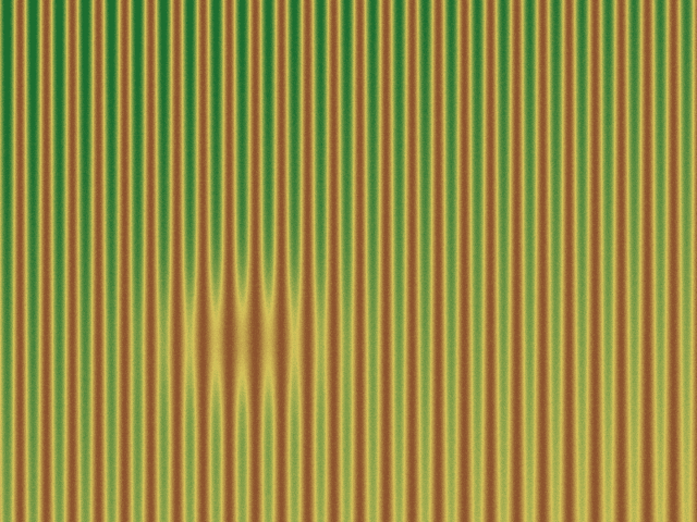
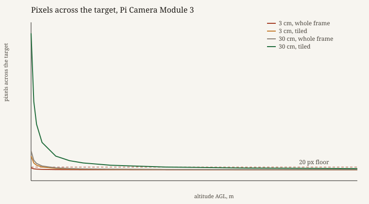
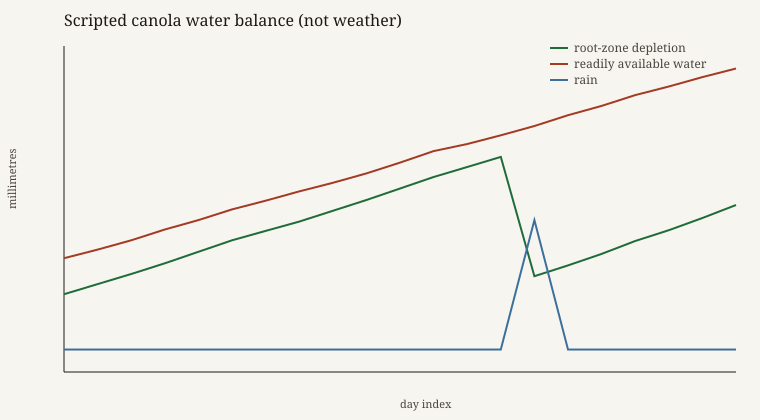
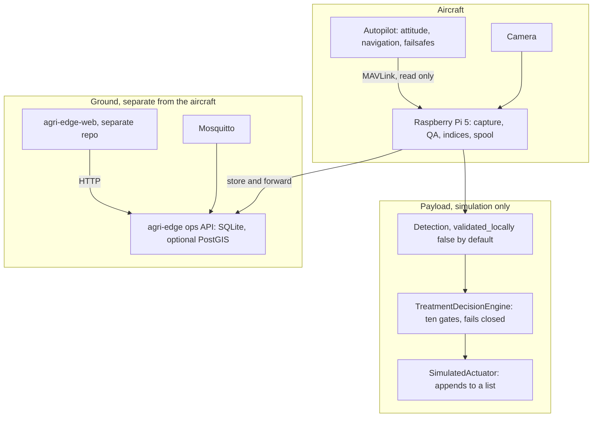

# agri-edge

Agri-Edge is the companion-computer brain for agricultural drone scouting.
A Raspberry Pi rides along with an autopilot, keeps the pictures, checks
whether they are usable, and refuses to turn a model score into a spray
command. The autopilot keeps the aircraft in the air. This process does not.

The problem it is aimed at is a practical one. A weed map is only useful if
the camera could actually see the weed, the frame still has a position, and
nobody has wired a false positive to a pump. Most of the work in this
repository is those gates, plus the ground-side agronomy that would consume
the pictures later: vegetation indices, a treatment geofence, water balance,
and an operations API. It runs on a laptop with no aircraft attached. Nothing
in the run below is a field measurement.

The farmer-facing site is a separate repository, [agri-edge-web](https://github.com/Anwarito-lbd/agri-edge-web), deployed at [agri-edge-web.vercel.app](https://agri-edge-web.vercel.app). On 13 November 2026 that URL answered HTTP 200 with the title “agri-edge — Aerial crop scouting software prototype”. The GitHub repository is private; this environment could not read its tree. This repo does not contain the website, and it should not.

## What a laptop run actually produced

`python scripts/portfolio_demo.py` on 13 November 2026 at 02:11:22 UTC, on commit `12b4267`, wrote `docs/proof/`. ArduPilot SITL was not started: `vendor/ardupilot` is not in the tree, and `summary.json` records `sitl_ran: false`.

### 1. Plan the passes, then play them back

`geo/coverage.py` turns a field polygon into parallel passes. Spacing is the swath times one minus the overlap, not the raw camera footprint. A line that lands exactly on an edge disappears under the half-open crossing rule, so the planner centres the set and insets it. Concave ground, a slough or a notch, splits one pass into two runs so the aircraft does not record the gap as covered.

The demo field is a synthetic polygon in local metres, 9.12 ha, with a rectangular notch. Swath 30 m, overlap 0.2, so the lines are 24 m apart. `best_heading` searches every 5° and keeps the heading with the least total distance, including the connectors between lines.

| | Observed |
|---|---:|
| Best heading | 90° counter-clockwise from east |
| Lines | 18 |
| Distance on lines | 3,780 m |
| Distance in turns | 408 m |
| Total | 4,188 m |
| Worst heading in the same sweep (175°) | 5,314 m |
| Time at 5 m/s plus the planner’s 4 s turn placeholder | 905.6 s |
| Field farther than half a swath from any line | 3.12% |

The 4 s turn cost is the comment in `CoveragePlan.estimate_duration_s`: a placeholder, not a stopwatch on an airframe. The 3.12% gap is `coverage_gaps` sampling the polygon on an 80×80 grid. It is an independent check, and on this notched field it does not come out at zero.



Green segments are the photo passes. Dashed segments are the turns, which collect nothing. The dots are the kinematic playback written to `docs/proof/telemetry.csv`: constant 5 m/s, no wind, no attitude, one sample every 0.5 s. That is a drawing of the plan, not a flight dynamics model.



### 2. Fly the capture pipeline in simulation

The second run is the real command:

```bash
python -m agri_edge.cli -c config/demo.yaml fly --simulate --frames 12 \
  --bands red,green,blue,nir,red-edge
```

`config/demo.yaml` asks for 320×240 frames at 0.25 s so a laptop spool stays small. The QA blur threshold is the same 100 used in `config/example.yaml`. `--simulate` builds `SimulatedTelemetry` and `SimulatedCamera`. Telemetry flies due east at 10 m/s from 50.4452 N, 104.6189 W, the default in that class, at 100 m above the home point, reporting an RTK-fixed fix. The camera paints crop rows, a vigour gradient, and a stressed ellipse. The detector is `SimulatedEngine`: excess-green blobbing, explicitly not a weed model, `validated_locally` false.

From `docs/proof/cli_fly.log` and `docs/proof/summary.json`:

| | Observed |
|---|---|
| Frames captured / QA pass / spool | 12 / 12 / 12 |
| Laplacian blur | 188.6 to 190.4, all above the threshold of 100 |
| Eastward travel | 27.52 m (wall-clock time × 10 m/s) |
| Detections | 12, each one full-frame box labelled `vegetation` at confidence 1.0 |
| `validated_locally` | false on every detection |
| `may_drive_treatment` | false on every detection |
| `decision_support_only` | true on every sidecar |
| Spool priority | ANOMALY on all 12, because a detection was present |
| Spool size | 18,482,002 bytes, then the arrays were deleted |
| Inference errors | 0 |

Preflight on the same config passed, and warned that the model is not locally validated. The straight-line track is short because the simulator integrates real elapsed time and twelve frames do not take long.

The first spooled frame, scaled 2× with nearest-neighbour so it is readable:





NDVI is `(NIR − Red) / (NIR + Red)`, from `geo/indices.py`. On that frame it was uncalibrated digital numbers, valid on every pixel, minimum −0.505, median 0.022, mean 0.0163, maximum 0.674. The yellow patch is the stressed ellipse the camera drew. `calibrated` is false, so this must not be compared with another date. The mean sits near zero because healthy rows and the stressed patch cancel; the picture is the result, not the mean.

`agri-edge indices` shows the same rule for a missing band. Red, green, NIR and red-edge produce NDVI, NDRE, GNDVI and SAVI, and refuse excess-green because blue is absent (`docs/proof/cli_indices.log`). Adding blue makes excess-green available (`docs/proof/cli_indices_with_blue.log`).

### 3. The treatment gate, still simulated

`decision/engine.py` will record a command on `SimulatedActuator` only when every gate passes. There is no pump behind it, and the engine refuses an actuator whose `simulated` attribute is not exactly `True`. The eight cases in `docs/proof/decisions.json` use the same local frame as `tests/test_decision_engine.py` (origin 49.8951 N, 97.1384 W, a 200 m square, 10 m buffer). One case was allowed and wrote one simulated command. The other seven wrote none.

| Case | Allowed | Reason |
|---|---|---|
| Every gate satisfied | yes | |
| Operator not armed | no | `NOT_OPERATOR_ARMED` |
| Model not locally validated | no | `MODEL_NOT_VALIDATED` |
| Confidence 0.40, threshold 0.85 | no | `CONFIDENCE_BELOW_THRESHOLD` |
| Point 180 m east of the field | no | `OUTSIDE_TREATMENT_GEOFENCE` |
| Mission paused | no | `MISSION_STATE_NOT_PERMITTED` |
| Command already expired | no | `COMMAND_EXPIRED` |
| Latitude is NaN | no | `POSITION_INVALID`, `GEOFENCE_NOT_EVALUATED` |

The capture run and this gate are separate on purpose. The capture detector is not validated, so the flight sidecars stay decision-support. The one allowed decision above is a hand-built input used to show the gate opening, and the actuator list is the only place that command went.

### 4. Optics, and a published ET0 check

Ground sample distance, pinhole model, in `training/gsd_calculator.py`:

```
ground width (m) = (sensor width mm / focal length mm) × altitude
native GSD (cm/px) = ground width × 100 / image width
```

For the IMX708 (6.45 mm sensor, 4.74 mm lens, 4608 px) letterboxed to 640 px, the downscale is 7.2×. A target needs 20 px across it. From `docs/proof/gsd_3cm.log` and `gsd_30cm.log`:

| Target | Whole-frame ceiling | Tiled ceiling |
|---|---:|---:|
| 3 cm seedling | 0.7 m AGL | 5.1 m AGL |
| 30 cm plant | 7.1 m AGL | 50.8 m AGL |

At 30 m a 3 cm seedling is 0.5 px whole-frame and 3.4 px tiled. It is not in the picture in any useful sense. A 30 cm target at the same altitude is 33.9 px tiled, native GSD 0.886 cm/px.



Motion blur holds the smear to one native pixel, so exposure must be `gsd / speed`. At 30 m and 5 m/s that is 1.77 ms (`docs/proof/motion_budget.log`). Rolling-shutter skew uses a 33 ms full-frame readout that the script tells you to measure rather than trust. Under that assumption the frame stays inside 5 px of skew only up to 1.3 m/s. Across one 30 cm target the readout is 0.43 ms, and at 5 m/s the target itself moves 0.24 px, so the skew is a mapping problem more than a detection problem.

FAO-56 Example 18, Brussels on 6 July, is the published check of `et0_penman_monteith`. The function returned 3.880 mm/day against the paper’s 3.9 mm/day. The water-balance chart is not weather. It is 21 days of temperatures written in `scripts/portfolio_demo.py`, canola on loam, seeded 20 May 2026. Depletion was 26.8 mm on 14 June and 10.2 mm on 15 June after the scripted 18 mm of rain. The stress coefficient stayed 1.0 the whole way, because root growth kept readily available water ahead of depletion. Final day, 21 June: depletion 20.1 mm, readily available water 39.1 mm.



### Tests

`python -m pytest -q` on the same day: **1900 passed, 30 skipped, 37.60 s** (`docs/proof/pytest.log`). The skips are the tests that need a live broker, PostGIS, or hardware. `tests/test_portfolio_demo.py` re-runs the demo for three frames so the artifact writer cannot rot quietly.

## Architecture



The Pi never gets a method that arms the aircraft, changes mode, or uploads a mission. `telemetry/mavlink_link.py` is read-only. Mission commands, later, would have to go through `vehicle/adapter.py` and the safety supervisor, and they fail closed today. Irrigation is a ground MQTT topic. It is not bridged to MAVLink.

| Module | Role |
|---|---|
| `pipeline/runner.py` | One frame: telemetry freshness, capture, QA, inference, index summaries, spool |
| `capture/camera.py` | Picamera2, or the synthetic multispectral scene |
| `telemetry/mavlink_link.py` | Read-only MAVLink, or the straight-line simulator |
| `qa/checks.py` | Blur, exposure, GNSS, bands, attitude. A failure is spooled, not deleted |
| `geo/indices.py` | NDVI, NDRE, GNDVI, SAVI, excess green. Arithmetic, not a prescription |
| `geo/georeference.py`, `geo/georef.py` | Pixel ray to a flat ground plane, plus a pose gate and an uncertainty budget |
| `geo/coverage.py` | Boustrophedon passes and the gap check |
| `geo/geofence.py` | Flight boundary, and a smaller boundary where treatment is even eligible |
| `inference/` | YOLOX decode in numpy, ONNX and Hailo backends, green-on-brown, tiling |
| `decision/engine.py` | The ten treatment gates. Simulation only |
| `agronomy/` | FAO-56 ET0, water balance, growth stage, disease and frost risk |
| `ops/` | Operations API, alerts, MQTT ingest, prescriptions |
| `vehicle/` | Adapter and safety supervisor. Commands fail closed |
| `training/` | Laptop only. Torch and YOLOX never ship on the aircraft |
| `ground_iot/` | Mosquitto and Node-RED compose. Not vendored into `src/` |

A longer note on the capture loop, the datasets, and why the model is YOLOX rather than an AGPL detector is in [docs/EDGE_PIPELINE.md](docs/EDGE_PIPELINE.md). Capability rows, including what has never seen hardware, are in [docs/status.md](docs/status.md). The build order is [docs/MASTER_IMPLEMENTATION_SPEC.md](docs/MASTER_IMPLEMENTATION_SPEC.md).

## How the maths fits together

**Where to fly.** Rotate the polygon so the passes are horizontal, clip each horizontal line against the boundary, rotate back, and alternate direction. Effective spacing is `swath × (1 − overlap)`. `coverage_gaps` then samples the field and measures distance to the nearest segment, so a spacing bug shows up as unseen ground.

**Where a pixel is.** A pixel is a ray in the camera frame. Aircraft attitude rotates it. It is intersected with a horizontal plane one AGL altitude below the vehicle. At 30 m, 10° of tilt moves the frame centre about 5.3 m, which is why a flat “GSD times pixel offset” is not used. The uncertainty attached to that point is the root-sum-square of terrain, GNSS, heading, attitude and half a pixel. The module says the terrain term defaults to 2 m and has not been checked on a real field.

**Whether anything may be applied.** Ten gates, all required: operator arm, payload arm, confidence, local validation, a finite position, a fresh level pose, the treatment geofence recomputed here rather than trusted from the detection, a healthy simulated actuator, mission state `TREATMENT_ACTIVE`, and a single unexpired human command. A missing input is a refusal.

**What the index means.** NDVI on raw digital numbers describes that frame. It does not describe the crop across a season. The pipeline stores `calibrated: false` for that reason.

## Tools actually declared in this repo

From `pyproject.toml`. The core install is what the Pi is supposed to carry.

| | Packages |
|---|---|
| Runtime | `numpy>=1.24`, `pyyaml>=6.0` |
| Extra `mavlink` | `pymavlink>=2.4` |
| Extra `camera` | `picamera2>=0.3` |
| Extra `cv` | `opencv-python-headless>=4.9` |
| Extra `geo` | `rasterio>=1.3` |
| Extra `onnx` | `onnxruntime>=1.17` |
| Extra `sensors` | `adafruit-circuitpython-bme280>=2.6` |
| Extra `mqtt` | `paho-mqtt>=2.0` |
| Extra `dev` | `pytest>=8.0` |

`Makefile` also calls `ruff` and `mypy`. They are installed by `make bootstrap`, not imported by the aircraft.

There is no `package.json` and no Dockerfile in this repository. Ground services are `ground_iot/docker-compose.yml`: `eclipse-mosquitto:2` and `nodered/node-red:4.0`. A second compose file sketches PostGIS; `docs/status.md` records that it has not been started.

Training experiments import YOLOX (`training/exps/`). PyTorch is not a core dependency and is not listed in `pyproject.toml`. Model cards under `models/` record earlier held-out numbers. Those weights are not in git (`models/*.onnx` is ignored), and this portfolio run did not re-evaluate them.

Third-party boundaries are listed in `third_party/manifest.yaml`: YOLOX (Apache-2.0), ONNX Runtime, Hailo, ArduPilot (GPL-3.0, process boundary only), pymavlink, OpenWeedLocator, farmOS, WebODM. None of those trees are vendored into `src/`.

## Run it locally

Python 3.10 or newer. The suite here ran on 3.12.

```bash
python -m pip install -e ".[dev]"
python scripts/portfolio_demo.py          # writes docs/proof/
python -m pytest -q                       # 1900 passed, 30 skipped on 13 Nov 2026
python -m agri_edge.cli -c config/example.yaml preflight --simulate
python -m agri_edge.cli -c config/example.yaml fly --simulate --frames 20
python -m agri_edge.cli indices red,green,nir,red-edge
python training/gsd_calculator.py --camera imx708 --target-size 3
python training/motion_budget.py --camera imx708 --altitude 30 --target-size 30
```

`config/example.yaml` uses the full Camera Module 3 resolution. Twenty frames at that size are a large spool. `config/demo.yaml` is the small one the proof was generated from.

ArduPilot SITL is `bash scripts/sitl.sh`, and it needs a local ArduPilot build. That binary was not present for the run above. Hailo compilation is `scripts/hailo_compile.sh`, x86_64 Linux only, and it stops without the Dataflow Compiler. The Pi provisioning script is `scripts/pi_setup.sh`, and it is meant to be run on the Pi.

`python -m agri_edge.ops.api` serves the operations station on `http://127.0.0.1:8765/ops/`. It comes up on seeded demo data.

## What this is not

No row in `docs/status.md` is marked field-validated. Live camera, a compiled Hailo model, a physical pump, and field radios are blocked on hardware that was not attached. The simulated actuator recording a command is the end of the treatment path. `preflight` checks the edge software. It does not check airspace, weather, or a pesticide label.
