# Agri-Edge Unified Platform

**Fail-closed agricultural drone scouting runtime, 3D airframe CAD & flight/spray physics, Apache-2.0 YOLOX-s perception toolchain, and Next.js 16 Operations Station.**

> **Honesty & Verification Status:** Every flight track, endurance curve, camera capture, vegetation index map, spray-gate log, and web screenshot in this repository comes from **deterministic simulation, parametric physics, or local test benches** (`SIMULATED` / `DEMO MODE`). No physical aircraft has flown, no `.hef` model has executed on live Hailo silicon, and no spray valve has actuated on a field crop (`validated_locally: false` across `ai/model_registry/registry.json` and `docs/status.md`).

<p align="center">
  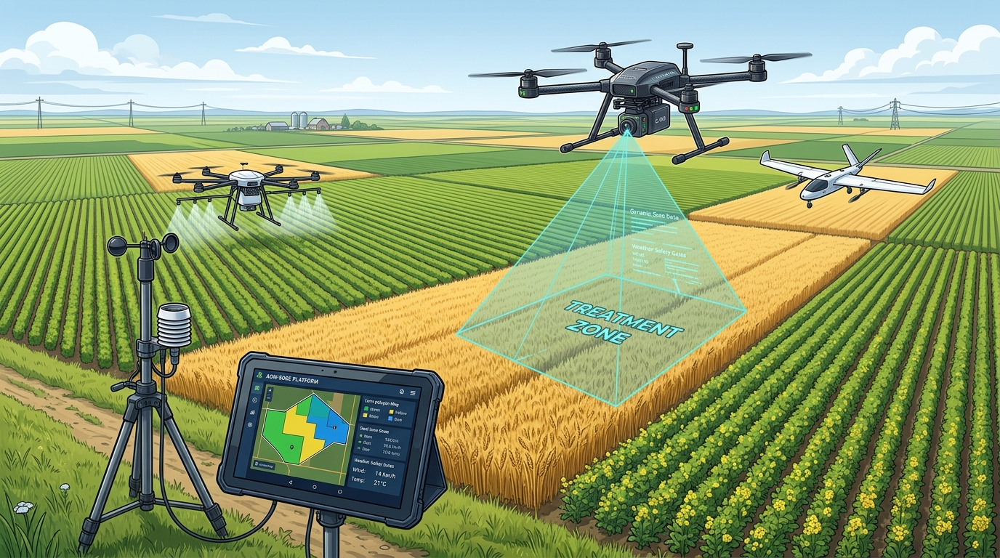
  <br />
  <sub><em><strong>Concept / Illustrative Art (not field telemetry):</strong> Three agricultural platform classes coordinated around one fail-closed ground station — Tier 1 650 mm X-quad scouting CAD (<code>mechanical/</code>), Tier 2 broad-acre survey VTOL profile, and Tier 3 precision treatment tier anchored by a ground-mast wind station.</em></sub>
</p>

---

## Live Unified Platform Overview

Originally developed across two separate repositories — `Anwarito-lbd/agri-edge` (companion runtime, ML training, airframe CAD, ops API) and `Anwarito-lbd/agri-edge-web` (farmer & operations PWA) — the entire stack now lives in one cohesive monorepo (`src/agri_edge/`, `training/`, `mechanical/`, `workstation/`, `apps/web/`).

| Verification Layer | Suite / Command | Latest Observed Result |
|---|---|---|
| Python Runtime Boundary | `pytest tests/test_runtime_deps.py -q` | **247 passed** (verifies clean Pi core dependencies) |
| Full Python Test Suite | `pytest -q` | **2,082 passed, 40 skipped** (live hardware / PostGIS / Hailo skips) |
| Python Linter & Static Types | `ruff check` · `mypy src/agri_edge` | **0 lint errors** · **7 mypy warnings/errors** across 122 files (ratchet <= 11) |
| Physics & Flight Sim Script | `python scripts/simulate_airframe_physics.py` | **4 verification plots + `physics_sim_summary.json`** (`test_simulate_airframe_physics.py` passes) |
| Operations Web Typecheck & Lint | `npm run typecheck` · `npm run lint` (`apps/web/`) | **0 TypeScript errors** · **0 ESLint errors** (3 pre-existing hook warnings) |
| Operations Web Unit Tests | `npm test` (Vitest in `apps/web/`) | **7 files, 124 tests passed** |
| Operations Web Production Build | `npm run build` (Next.js 16.3.5 + React 19.2.8) | **22 routes compiled cleanly** |

---

## Unified Edge-to-Web Architecture

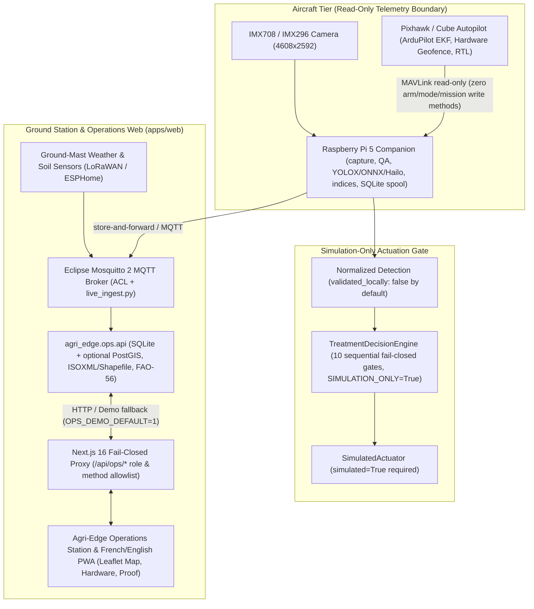

The companion computer never owns flight stability: `src/agri_edge/telemetry/mavlink_link.py` exposes no arming, mode-switching, or mission-upload methods. Future mission adapters (`src/agri_edge/vehicle/adapter.py`) fail closed inside `SafetySupervisor`, and irrigation / spray actions never cross directly onto MAVLink.

---

## Operations Station Web UI & Walkthrough (`apps/web/`)

Running Next.js `16.3.5` and React `19.2.8` against deterministic `DEMO / SIMULATED` state (`OPS_DEMO_DEFAULT=1` when `OPS_API_URL` is offline), the unified web station enforces fail-closed `/api/ops/*` proxy policies (`apps/web/src/lib/ops-proxy-policy.ts`) and never queues write mutations in its offline service worker (`apps/web/public/sw.js`).

### Real Playwright Walkthrough Recording (Desktop `1280x720`)


- Full MP4 walkthrough (`1.85 MB`, H.264): [`docs/proof/agri-edge-walkthrough.mp4`](docs/proof/agri-edge-walkthrough.mp4)
- Full WebM recording (`5.63 MB`, Playwright `recordVideo`): [`docs/proof/agri-edge-walkthrough.webm`](docs/proof/agri-edge-walkthrough.webm)

### Verified Headless Browser Screenshots (Desktop `1440x900` & Mobile `390x844`)

| Ops Station Landing (Desktop) | Hardware, Fleet Tiers & YOLOX-s Page |
|---|---|
| 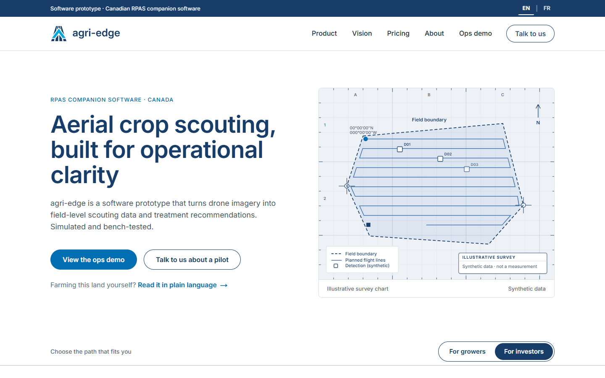 | 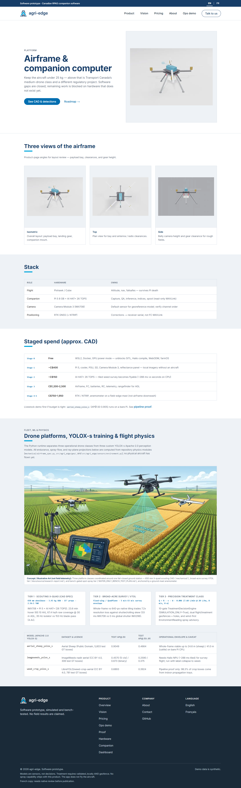 |
| **Operations Field Map (`leaflet`)** | **Physics & Simulation Proof Gallery (`/proof`)** |
| 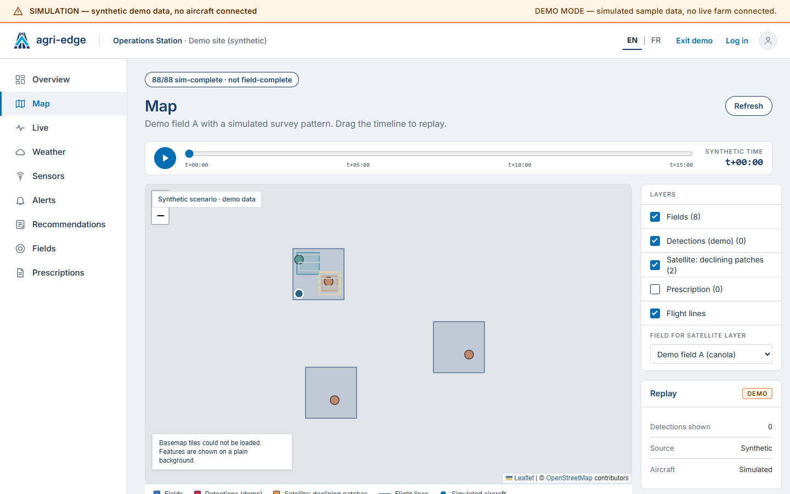 | 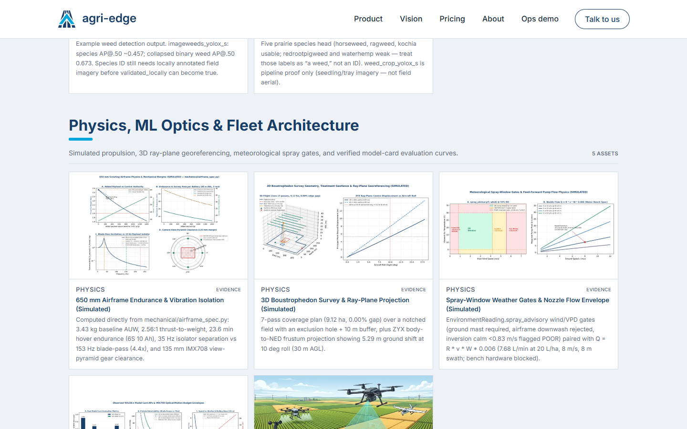 |
| **Mobile Landing (`390x844`)** | **Mobile Operations View (`390x844`)** |
| 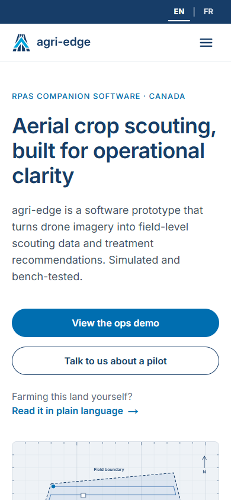 | 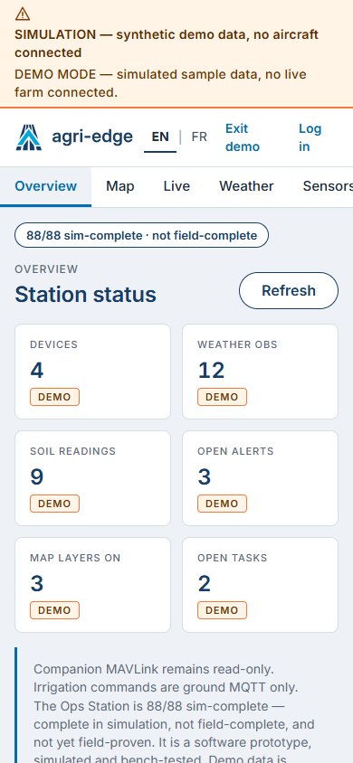 |

---

## ML Model Training Pipeline, Optics & Honest Dataset Audits (`training/`, `models/`)

Agri-Edge restricts deployed weights to **Apache-2.0 Megvii YOLOX-s** (`depth=0.33`, `width=0.50`, `8.94M` parameters), intentionally excluding AGPL/GPL detector families (`NOTICE.md`). Models export to static `640x640` ONNX opset 11 (`training/export_onnx.py`) with **raw un-decoded head output** (`decode_in_inference = False`), explicit SiLU expansion for Hailo NPU compatibility, `PAD_VALUE = 114` RGB uint8 letterboxing, and host-side NumPy NMS (`src/agri_edge/inference/yolox.py`). Crucially, `training/evaluate.py` benchmarks the **deployed `OnnxEngine`** rather than training-time PyTorch hooks.

### Engineering Hardening in `training/`
- **Crash-Resilient Training (`training/train_resilient.py`):** Catches transient CUDA/cuDNN drops, resumes automatically with `--resume`, and treats YOLOX's `finally:` exit banner as incomplete unless the target final epoch appears in `train_log.txt`.
- **PyTorch 2.6+ & Windows Evaluation (`training/exps/*_yolox_s.py`):** Allowlists NumPy scalar globals in `torch.serialization.add_safe_globals` for safe checkpoint resumption and stubs `yolox.layers.fast_coco_eval_api` to `None` so COCO AP uses `pycocotools` cleanly without MSVC/ninja JIT compilation.

### Measured Model Cards (`models/*_CARD.md`) & Physics Optics Envelope

| Model Artifact (`640x640` ONNX) | Dataset & Licence | Test GT Boxes | Test AP@.50 | Test AP@.50:.95 | Operational Envelope & Caveat |
|---|---|---:|---:|---:|---|
| `aerial_sheep_yolox_s` | Aerial Sheep (Public Domain) | 5,603 (174 imgs) | **0.9049** | **0.4664** | Up to 105 sheep/frame (`max_labels` raised 50 -> 150 / 450 mosaic); CPU-viable on bare Pi 5 up to 24.6 m AGL. |
| `imageweeds_yolox_s` | ImageWeeds (CC BY 4.0) | 306 (70 plots) | **0.4570** (5-cls) / **0.673** (binary) | **0.2590** / **0.375** | Real `5472x3648` Prairie field plots; only potted weeds annotated (`horseweed 0.7926` vs `waterhemp 0.0726`); deploy with `collapse_labels_to: weed`. |
| `weed_crop_yolox_s` | LibreYOLO weed-crop (CC BY 4.0) | 781 (118 imgs) | **0.6893** (`crop 0.6301`, `weed 0.7485`) | **0.3924** | **Pipeline proof only (`validated_locally: false`)**: 98.3% of crop annotations sit in indoor propagation trays. |
| `yolox_s_coco` | Stock MS COCO baseline | 80 classes | — | — | Generic ONNX runtime & Hailo export smoke test (`models/yolox_s_coco.onnx.meta.json`). |

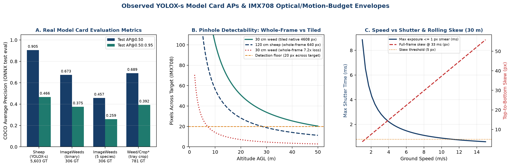

Using `training/gsd_calculator.py` and `training/motion_budget.py` on the **IMX708** ($6.45 \times 3.63\text{ mm}$ sensor, $4.74\text{ mm}$ lens, $4608 \times 2592\text{ px}$), whole-frame $640\text{ px}$ downscaling imposes a **$7.2\times$ resolution loss**: at $30\text{ m}$ AGL ($\text{GSD}_{\text{native}} = 0.886\text{ cm/px}$), a $3\text{ cm}$ seedling spans $3.39\text{ px}$ tiled but only **$0.47\text{ px}$** whole-frame. Keeping motion smear $\le 1\text{ px}$ at $5\text{ m/s}$ requires $\le 1.77\text{ ms}$ shutter (or $\le 2.31\text{ ms}$ under `Airframe().performance()`'s $1.155\text{ cm/px}$ survey model), while uncalibrated $33\text{ ms}$ full-frame rolling shutter exceeds $5\text{ px}$ skew above $1.3\text{ m/s}$.

---

## Three Drone Platform Tiers, CAD & Flight / Spray Physics

`scripts/simulate_airframe_physics.py` executes the repository's real mechanical, georeferencing, coverage, geofencing, and environmental models (`docs/proof/physics_sim_summary.json`):

### 1. Tier 1 — 650 mm Parametric Scouting X-Quad (`mechanical/airframe_spec.py`)
- **Mass & Propulsion Budget (`100%` estimated):** **$3,432\text{ g}$** AUW ($1,100\text{ g}$ frame, $600\text{ g}$ propulsion, $145\text{ g}$ avionics, $1,250\text{ g}$ 6S 10Ah battery, $337\text{ g}$ payload), `15 in` 2-blade props ($79\text{ mm}$ tip gap), $2,200\text{ g}$ thrust/motor (**$2.564:1$ TWR**, $0.39$ hover throttle, $411.33\text{ W}$ hover power including $30\text{ W}$ avionics), **$+950\text{ g}$ max payload margin** at $\text{TWR} \ge 2.0$.
- **Endurance & Isolation:** **$23.55\text{ min}$** hover / **$20.55\text{ min}$** survey (**$67.44\text{ ha/h}$**, **$23.10\text{ ha/battery}$**) on 6S 10Ah ($37.68\text{ min}$ on 6S 16Ah). Payload isolator tuned to **$35.0\text{ Hz}$** ($k = 3.87\text{ N/mm}$, $0.203\text{ mm}$ sag) yields **$4.38\times$ separation** below $153.33\text{ Hz}$ hover blade-pass ($226.67\text{ Hz}$ full). Landing legs at $260\text{ mm}$ radius retain **$135\text{ mm}$ clearance** outside the IMX708 FOV (`in_frame = False`). CAD artifacts live in `mechanical/handoff/` (`.blend`, `.glb`, 8 `.stl` files, 4 orthographic renders).

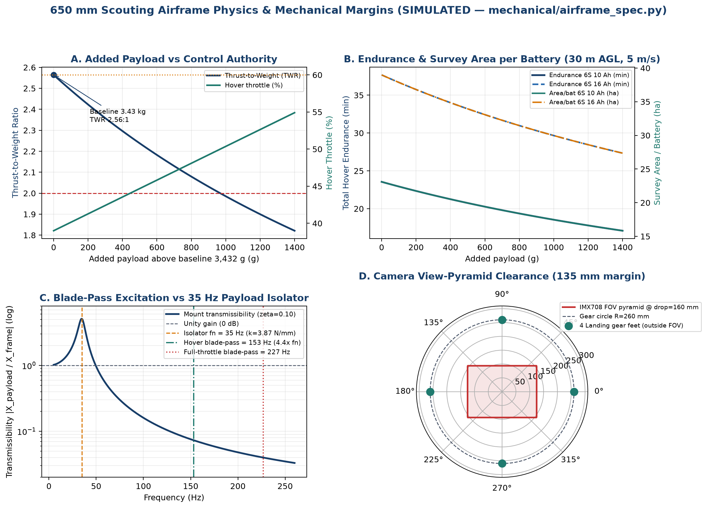

### 2. Tier 2 — Broad-Acre Survey / VTOL & 3D Ray-Plane Georeference (`geo/coverage.py`, `geo/georeference.py`)
- `best_heading` optimizes boustrophedon passes across an irregular $9.12\text{ ha}$ notched polygon ($0.0^\circ$ optimum over $2,715\text{ m}$ total track at $37.47\text{ m}$ effective swath, $0.000$ gap fraction under $46.84\text{ m}$ airframe swath).
- Full ZYX Euler body-to-NED ray intersection (`georeference.py`) models real attitude displacement: at $30\text{ m}$ AGL, a **$10^\circ$ roll shifts the principal ground point by $5.29\text{ m}$**, which simple flat-GSD pixel offsets miss.

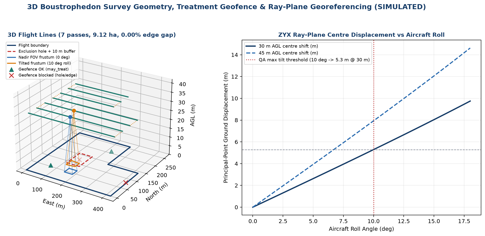

### 3. Tier 3 — Precision Treatment Actuation, Drift Envelope & Geofencing (`geofence.py`, `sensors/environment.py`, `WATER_ONLY_BENCH_TEST_PLAN.md`)
- Feed-forward flow rate $Q = R \cdot v \cdot W \cdot 0.006$ evaluates to **$7.68\text{ L/min}$** at $20\text{ L/ha}$, $8\text{ m/s}$, $8\text{ m}$ swath ($23.04\text{ ha/h}$ gross rate).
- `EnvironmentReading.spray_advisory` rejects `wind_source="airframe"`, flags calm inversion conditions ($w < 0.83\text{ m/s}$), excessive drift ($w > 5.56\text{ m/s}$), and high evaporation ($\text{VPD} > 2.0\text{ kPa}$ or $T > 30^\circ\text{C}$, $\text{RH} < 40\%$) as `poor`. `TreatmentGeofence` with an inner exclusion hole cleanly blocks out-of-bounds or masked targets (`2` allowed, `2` blocked).

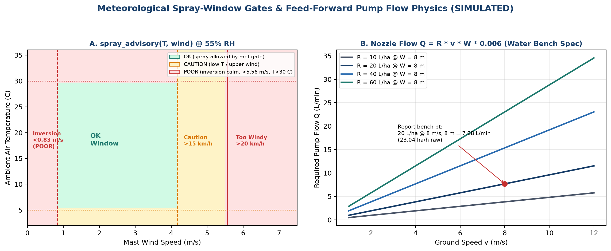

---

## Companion Capture, 10-Gate Interlock & FAO-56 Demo (`scripts/portfolio_demo.py`)

Running `python scripts/portfolio_demo.py` exercises the standalone end-to-end edge pipeline (`docs/proof/summary.json`, `coverage.json`, `decisions.json`, `agronomy.json`):

- **Boustrophedon Coverage (`30 m` swath, `20%` overlap -> `24 m` spacing):** `90°` optimal heading, `18` passes, `3,780 m` line + `408 m` turn = `4,188 m` (`905.6 s`, `3.12%` unvisited notch gap on `80x80` grid).
- **Simulated 5-Band Capture (`config/demo.yaml`, 12 frames):** 12/12 captured, QA Laplacian `188.6–190.4` (threshold `100`), `27.52 m` travel, uncalibrated NDVI `-0.505` min / `0.0163` mean / `0.674` max (`calibrated: false`), `validated_locally: false` and `may_drive_treatment: false` on all detections.
- **10-Gate Decision Matrix (`decisions.json`):** `1` synthetic command allowed, `7` failed closed (`NOT_OPERATOR_ARMED`, `MODEL_NOT_VALIDATED`, `CONFIDENCE_BELOW_THRESHOLD`, `OUTSIDE_TREATMENT_GEOFENCE`, `MISSION_STATE_NOT_PERMITTED`, `COMMAND_EXPIRED`, `POSITION_INVALID` + `GEOFENCE_NOT_EVALUATED`).
- **FAO-56 Penman-Monteith (`agronomy/et0.py`):** Matches FAO-56 Example 18 Brussels (`3.880 mm/day` vs. `3.9 mm/day` reference); 21-day canola balance depletes `26.8 mm` -> `10.2 mm` (rain) -> `20.1 mm` with `Ks = 1.0`.

| Synthetic 5-Band RGB | Uncalibrated NDVI Frame | Boustrophedon Track | FAO-56 Water Balance |
|---|---|---|---|
|  |  |  |  |

---

## Tools, Skills, AI Models, MCP & Hardware/Sim Stack

All technologies listed below were directly inspected or executed inside this repository:

- **Core Edge Runtime (`pyproject.toml`):** Python `>=3.10` (verified on Python `3.12`), `numpy >= 1.24`, `pyyaml >= 6.0`, optional extras `pymavlink >= 2.4`, `picamera2 >= 0.3`, `opencv-python-headless >= 4.9`, `rasterio >= 1.3`, `onnxruntime >= 1.17`, `adafruit-circuitpython-bme280 >= 2.6`, `paho-mqtt >= 2.0`, `pytest >= 8.0`.
- **Operations Web & Ground IoT (`apps/web/package.json`, `ground_iot/`):** Next.js `16.3.5`, React `19.2.8`, TypeScript `^5`, Tailwind CSS `^4`, Leaflet `^1.9.4` + `react-leaflet ^5.0.0`, Vitest `^3.2.7`, ESLint `^9`, Eclipse Mosquitto `2`, Node-RED `4.0`, PostgreSQL + PostGIS optional schema.
- **ML Training & CAD Stack:** Megvii YOLOX-s (Apache-2.0, PyTorch `2.6+` checkpoint compatibility), ONNX opset 11 raw-head inference (`PAD_VALUE=114`, host NumPy NMS), `pycocotools`, `training/gsd_calculator.py`, `training/motion_budget.py`, Blender parametric airframe (`mechanical/blender_airframe.py`, `.blend`/`.glb`/`.stl`), Matplotlib (`scripts/simulate_airframe_physics.py`, `scripts/portfolio_demo.py`).
- **Target Hardware Architecture (Design / Bench-Pending):** Raspberry Pi 5 (8 GB) + Raspberry Pi AI HAT+ (Hailo-8 26 TOPS), Raspberry Pi Camera Module 3 (`IMX708`) / Global Shutter (`IMX296`), Pixhawk / Cube autopilot (ArduPilot MAVLink telemetry), ESP32-S3 / LoRaWAN weather mast sensors. *(No physical flight, Hailo NPU inference, or pressurized pump run executed yet.)*
- **Third-Party Boundaries (`third_party/manifest.yaml`, `NOTICE.md`):** Strict license isolation — zero Ultralytics AGPL-3.0/YOLOv6 code, GPL-3.0 ArduPilot separated over read-only MAVLink process boundary, CC BY 4.0 datasets credited in `NOTICE.md`.
- **Verification Tooling & Agent Context:** `pytest`, `ruff`, `mypy`, Vitest, `tsc --noEmit`, ESLint, `next build`, headless Chromium Playwright (`recordVideo` + responsive `1440x900` / `390x844` screenshots), and documentation/case-study proof engineering. No runtime production code in `src/` or `apps/web/` embeds or depends on external MCP servers or LLM agents.

---

## Quickstart & Verification Commands

### Python Edge & Physics Runtime
```bash
# Always point PYTHONPATH to src/ when developing locally without editable reinstall confusion
export PYTHONPATH="$(pwd)/src"   # PowerShell: $env:PYTHONPATH="$PWD\src"

python -m pip install -e ".[dev]"
python -m pytest tests/test_runtime_deps.py -q        # 247 passed
python -m pytest -q                                  # 2082 passed, 40 skipped
python -m ruff check src tests training workstation mechanical scripts
python -m mypy src/agri_edge --ignore-missing-imports

# Regenerate deterministic proof artifacts & physics plots
python scripts/portfolio_demo.py
python scripts/simulate_airframe_physics.py

# Start backend Ops API (seeded demo state on http://127.0.0.1:8765/ops/)
python -m agri_edge.ops.api
```

### Unified Operations Station (`apps/web/`)
```bash
cd apps/web
npm ci
npm run typecheck
npm run lint
npm test                         # 7 files, 124 tests passed
OPS_API_URL=http://127.0.0.1:1 npm run build
OPS_DEMO_DEFAULT=1 npx next start -p 3100
```

---

## Repository Documentation Index

- [`docs/CASE_STUDY.md`](docs/CASE_STUDY.md) — Engineering deep dive: read-only autopilot boundary, 10-gate spray interlock, IMX708 optics vs. YOLOX-s failure modes, and unified airframe/spray physics.
- [`docs/PROOF_OF_WORK.md`](docs/PROOF_OF_WORK.md) — Complete observed test ledger, benchmark artifacts, Playwright media manifest, and hardware-blocked boundaries.
- [`docs/status.md`](docs/status.md) — Component-by-component capability table distinguishing Code, Sim, Hardware, and Field status.
- [`docs/HARDWARE_PLAN.md`](docs/HARDWARE_PLAN.md) & [`docs/EDGE_PIPELINE.md`](docs/EDGE_PIPELINE.md) — Staged Pi 5 / Hailo / Pixhawk bring-up plan and camera-to-spool loop.
- [`NOTICE.md`](NOTICE.md) — Commercial license boundaries and dataset attributions.
