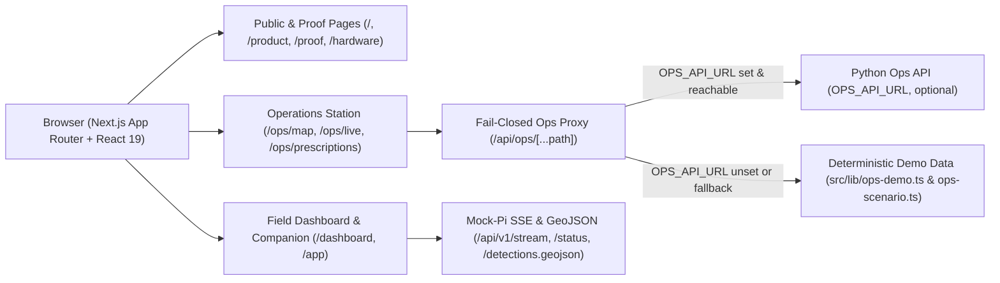
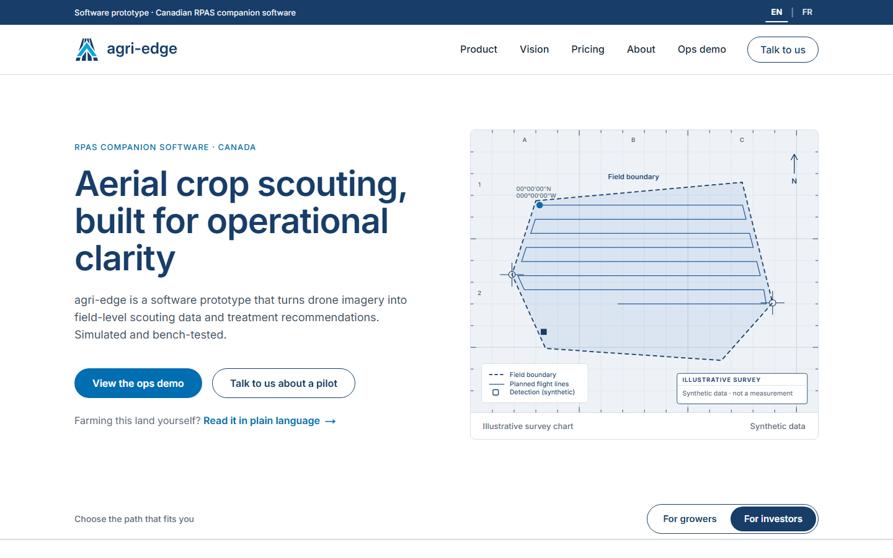
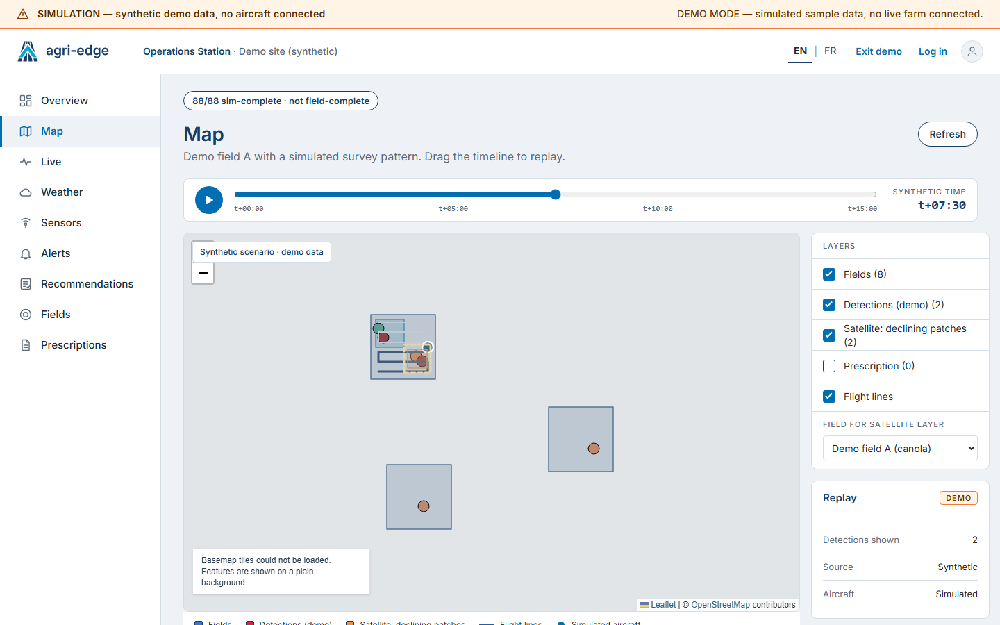
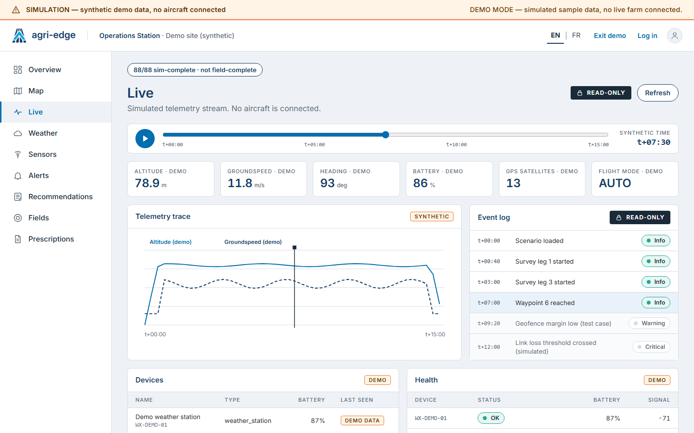
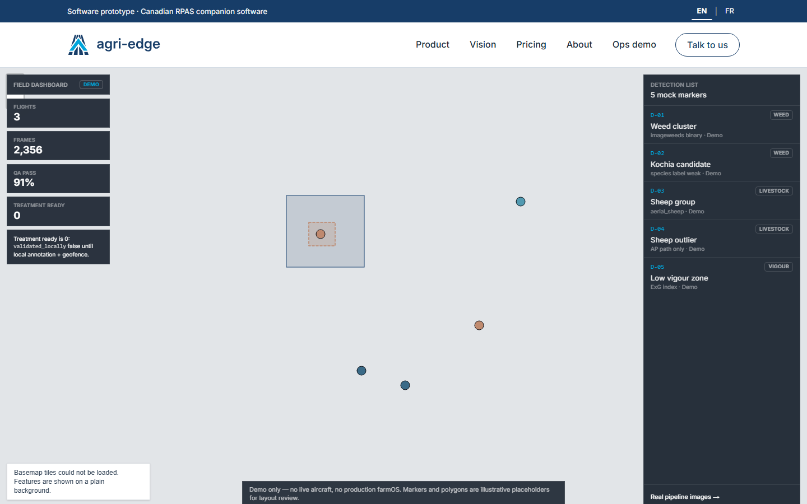
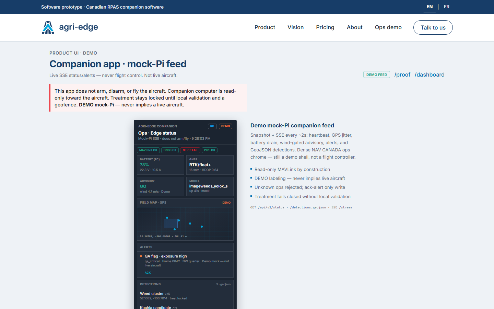
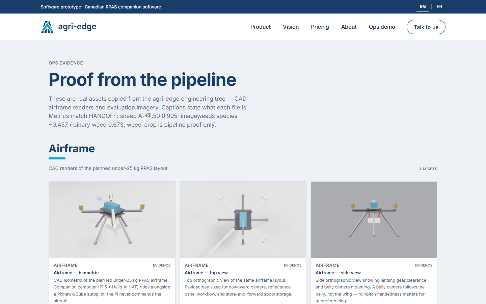

# agri-edge-web

Web product showcase, Operations Station UI, and read-only companion telemetry shell for **agri-edge** — a Canadian under-25 kg agricultural RPAS companion computer prototype (Raspberry Pi 5 + Hailo AI HAT + Pixhawk/Cube).

> **Honesty & Safety by Construction:** When `OPS_API_URL` is unset, `/ops`, `/dashboard`, and `/app` run in a clearly labeled **DEMO / SIMULATED** mode using deterministic synthetic data (`src/lib/ops-demo.ts`, `src/lib/ops-scenario.ts`, `src/lib/mock-pi/state.ts`). No route in this application can arm, disarm, or command an aircraft — the companion boundary is strictly **read-only MAVLink**, and the proxy allowlist in `src/lib/ops-proxy-policy.ts` blocks vehicle-action paths at the edge.

For the full route table, environment variable reference, authentication model, and offline service worker details, see [docs/README_DETAILED.md](docs/README_DETAILED.md). For the engineering narrative behind the safety and UX decisions, see [docs/CASE_STUDY.md](docs/CASE_STUDY.md).

---

## Architecture



---

## Drone & Map Demo Walkthrough

All screenshots below were captured from a live local production server (`next start`) using headless Chromium with `OPS_API_URL` unset (deterministic demo mode).

### 1. Landing & Dual-Audience Framing (`/`)

The home page pairs an illustrative survey-grid hero with an investor/grower toggle (`?aud=grower`), EN/FR switching, and explicit prototype staging.



### 2. Operations Map & Synthetic Survey Replay (`/ops/map?t=450`)

Built with **React-Leaflet** (`src/components/ops/OpsMap.tsx`) and a deterministic 15-minute scenario clock (`src/lib/ops-scenario.ts`, `src/components/ops/OpsScrubber.tsx`). Scrubbing `t+00:00` to `t+15:00` advances the simulated aircraft along a 6-leg lawn-mower survey path, reveals detections progressively, and toggles farm boundaries, satellite NDVI decline patches, and prescription layers. When external OpenStreetMap tiles are unavailable, `BasemapTiles.tsx` degrades gracefully with an explicit notice while keeping vector overlays legible.



### 3. Live Telemetry Trace & Event Log (`/ops/live?t=450`)

Renders synchronized altitude (`m`), groundspeed (`m/s`), heading (`deg`), battery (`%`), and GNSS satellite KPIs alongside an SVG telemetry trace and a read-only scripted event log (`t+00:00` through `t+12:00`), plus device health and open alerts.



### 4. Field Dashboard (`/dashboard`)

Full-bleed React-Leaflet map (`src/components/DemoMap.tsx`) with floating KPI cards, mock detection markers (weed, livestock, vigour), and a `treatment ready = 0` safety reminder (`validated_locally` remains false until local annotation and geofence checks pass).



### 5. Mobile Companion Shell (`/app`)

Connects via Server-Sent Events (`EventSource` to `/api/v1/stream`) for ~2-second updates of heartbeat, GNSS RTK/float+ status, wind-gated GO/NO-GO advisory, GeoJSON detections, and ack-only alert handling (`POST /api/v1/alerts/[id]/ack`).



### 6. Pipeline Proof & CAD Evidence (`/proof`)

Displays real assets from the `agri-edge` engineering tree (`public/proof/`): CAD airframe views, classical ExG green-on-brown vs. YOLOX comparisons, sheep ground truth and predictions (`aerial_sheep_yolox_s`, **AP@.50 0.905**), and weed detections (ImageWeeds species ~**0.457** / binary **0.673**; `weed_crop` pipeline proof only).



---

## Verified Tech Stack

Exact dependencies and tooling from `package.json`:

| Category | Packages |
|---|---|
| Framework & Runtime | `next` (`16.3.5`), `react` (`19.2.8`), `react-dom` (`19.2.8`) |
| Mapping & Geospatial | `leaflet` (`^1.9.4`), `react-leaflet` (`^5.0.0`), `@types/leaflet` (`^1.9.22`) |
| Styling & Design Tokens | `tailwindcss` (`^4`), `@tailwindcss/postcss` (`^4`), `src/styles/tokens.css` & `tokens.json` |
| Language & Types | `typescript` (`^5`), `@types/node` (`^20`), `@types/react` (`^19`), `@types/react-dom` (`^19`) |
| Testing & Linting | `vitest` (`^3.2.7`), `eslint` (`^9`), `eslint-config-next` (`16.3.5`) |

---

## Local Setup & Verification

```bash
# 1. Install dependencies
npm install

# 2. Run development server (starts in DEMO mode if OPS_API_URL is unset)
npm run dev

# 3. Run typecheck, linter, and unit tests
npm run typecheck
npm run lint
npm test

# 4. Production build & start
npm run build
npm start
```

To connect the Ops Station UI to a local Python `agri-edge` Ops API instead of demo mode:

```bash
export OPS_API_URL=http://127.0.0.1:8765
npm run dev
```

---

## Documentation

- [docs/CASE_STUDY.md](docs/CASE_STUDY.md) — Engineering case study on fail-closed proxy design, deterministic simulation, and honest prototyping.
- [docs/README_DETAILED.md](docs/README_DETAILED.md) — Complete route table, environment variables, session cookie model, and design system notes.
