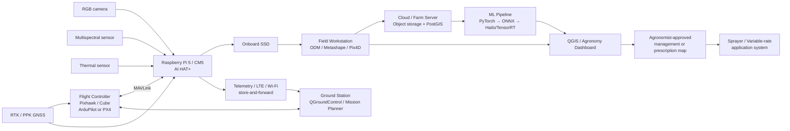
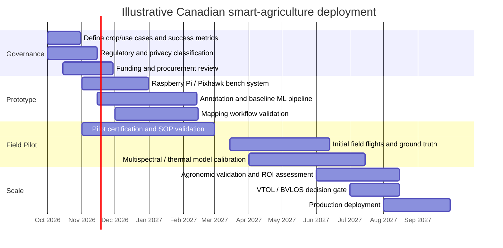

# Smart Agriculture in Canada: Drones, VTOL Systems and Raspberry Pi-Based Precision Agriculture

## Executive summary

Canada is now materially more favourable to agricultural drone deployment than it was even two years ago. Two regulatory changes are especially important. First, the November 2025 amendments to the Canadian Aviation Regulations created a **Level 1 Complex** category for defined lower-risk beyond-visual-line-of-sight (BVLOS) operations, while expanding Advanced-certificate privileges to medium drones, extended visual line of sight (EVLOS) and sheltered operations. Second, on **30 June 2026**, Health Canada changed its pesticide policy so that an RPAS may apply a pesticide already registered for conventional aerial application without a separate RPAS label amendment, provided the existing aerial label directions are followed; products that are not registered for aerial application still cannot simply be sprayed by drone. citeturn0search4turn0search2turn19search5

For an organisation entering Canadian smart agriculture without a specified crop or budget, the strongest strategy is **not** to buy one “do everything” drone. A three-tier fleet is technically and economically more sensible:

| Need | Recommended starting platform | Why |
|---|---|---|
| Routine crop scouting, NDVI and small/medium-field mapping | **DJI Mavic 3 Multispectral (M3M)** | Integrated RGB + four-band multispectral imaging and RTK in a compact system; Canadian retail pricing is roughly C$6,000–6,500. citeturn15search0turn21search0turn21search18 |
| Research, thermal work, custom payloads and high-end mapping | **DJI Matrice 400** or a custom Pixhawk/Raspberry Pi multirotor | Matrice 400 supports up to 6 kg of payload and multiple enterprise sensors; a custom platform gives far greater access to Raspberry Pi, ROS, MAVLink and experimental sensors. citeturn16search0turn16search5 |
| Large-area broad-acre mapping | **Quantum Systems Trinity Pro**; WingtraRAY as an alternative | VTOL removes runway requirements while fixed-wing cruise gives substantially greater area efficiency than a conventional multicopter. Trinity Pro advertises up to 90 minutes' endurance and multiple mapping payloads. citeturn17search1turn17search3 |
| Pesticide/fertiliser spraying | **DJI Agras T50** or current-generation Agras equivalent | Purpose-built 40 kg spraying / 50 kg spreading platform with a mature Canadian dealer ecosystem. Its weight pushes operations into Canada's medium-RPAS regulatory regime. citeturn14search1turn21search1turn21search11 |
| Close-up FPV inspection and R&D | **Custom 7-inch Pixhawk + Raspberry Pi FPV quad**; DJI Avata 2 only as a simple scout | FPV is useful for inspecting individual plants, irrigation, fencing and canopy structure but should not be treated as a quantitative photogrammetry platform. Avata 2 is about 377 g with up to 23 minutes' stated flight time. citeturn15search2turn14search2 |

The recommended computing architecture is **hybrid edge + workstation/cloud**. A Raspberry Pi 5 with an AI HAT+ is excellent for image-quality checks, event detection, low-latency weed/plant inference, telemetry integration and selective uploading. Raspberry Pi's current AI HAT+ is offered at 13 or 26 TOPS, while the newer AI HAT+ 2 provides 40 TOPS INT4 and 8 GB of accelerator memory. Full-field orthomosaic generation, dense reconstruction, DSM construction and multispectral mosaicking should normally happen on a powerful field workstation or in the cloud rather than on the aircraft. citeturn24search0turn24search8turn24search20

The best open technical foundation is **ArduPilot or PX4 + MAVLink/MAVSDK + Raspberry Pi OS/Ubuntu + OpenCV + GDAL/Rasterio + OpenDroneMap/WebODM + QGIS + PyTorch/ONNX Runtime**, adding Hailo acceleration when Raspberry Pi is doing real-time inference. Commercial Pix4Dfields, Agisoft Metashape or equivalent software becomes attractive when labour cost, support and repeatability matter more than software licence cost.

For a realistic first deployment, I would budget approximately **C$10,000–16,000 for a professional M3M mapping package**, **C$4,000–10,000 for a custom Raspberry Pi/Pixhawk research airframe and edge-compute laboratory**, **C$35,000–65,000 for a compliant spraying deployment**, and **C$40,000–90,000+ for a professional VTOL mapping system with specialised sensors and software**. Those are planning ranges rather than quotations; Canadian enterprise systems, sensor packages and subscriptions are frequently quote-based, while current Canadian T50 packages alone span approximately C$25,000 to C$40,000. citeturn21search1turn21search4turn21search11turn21search21

The most important procurement decision is therefore **mission architecture first, airframe second**: determine whether the initial commercial value is disease/stress detection, stand counting, weed mapping, water management, variable-rate prescription, crop insurance/documentation or spraying. Crop type, average field size, province, connectivity, desired ground-sampling distance and whether BVLOS is economically necessary remain unspecified and can shift the preferred system substantially.

## Canadian policy, regulation and regional priorities

**Current Canadian RPAS framework.** Transport Canada's November 2025 amendments substantially changed the agricultural-drone opportunity. Drones of 250 g or more must generally be registered, and their operations fall into Basic, Advanced, Level 1 Complex or SFOC pathways depending on aircraft, location and operation. Microdrones below 250 g do not require registration or a pilot certificate, although pilots remain responsible for safe and lawful operation and airspace restrictions still matter. citeturn1search0turn1search1turn26search23

The most consequential categories for agriculture are:

| Operational situation | Practical Canadian pathway as of September 2026 |
|---|---|
| Conventional VLOS mapping with a 250 g–25 kg drone in low-risk uncontrolled airspace | Usually **Basic** if all Basic conditions are met; otherwise Advanced. Registration and an appropriate pilot certificate apply. citeturn1search0turn26search23 |
| Controlled airspace, operations closer to/over people where permitted, EVLOS, or VLOS with a medium 25–150 kg aircraft | **Advanced Operations**. Controlled airspace additionally requires the applicable NAV CANADA/DND authorisation. citeturn0search6turn1search3 |
| EVLOS with a small RPAS | Advanced rules permit defined EVLOS operations in uncontrolled airspace using a qualified visual observer; the observer needs at least the required Basic qualification. citeturn1search3 |
| Lower-risk BVLOS in qualifying rural/uncontrolled environments | **Level 1 Complex**: Level 1 pilot certificate, qualifying aircraft/declarations and operation under an RPAS Operator Certificate (RPOC). citeturn0search2turn0search10 |
| Higher-risk BVLOS or an operation outside Basic/Advanced/Level 1 conditions | Normally an **SFOC-RPAS** or another applicable approval pathway. citeturn1search14 |

For lower-risk Level 1 Complex BVLOS, Transport Canada currently limits operations to uncontrolled airspace, normally at or below 122 m/400 ft AGL and with aerodrome/population restrictions. A small or medium drone can operate BVLOS in qualifying unpopulated areas more than 1 km from a populated area; additional provisions allow qualifying small aircraft with an accepted pre-validated declaration to operate over sparsely populated areas. Transport Canada also specifies separation from the centres of relevant aerodromes. citeturn0search2

A Level 1 Complex pilot must be at least 18, first meet the Advanced-exam prerequisite, complete at least 20 hours of ground school, pass the Level 1 Complex examination and complete the required flight review. The current Level 1 examination fee is C$50.85; Transport Canada lists a separate C$125 certificate issuance fee. The pilot certificate itself does not simply expire, but recurrent competency requirements apply. citeturn0search2turn0search7turn0search8

The operational burden should not be underestimated. An organisation undertaking Level 1 Complex operations must operate under an **RPOC**, with an accountable executive, maintenance responsibilities, training programme, SOPs and operational-risk processes. This means scalable agricultural BVLOS is increasingly possible, but it should be treated as an aviation programme rather than as an extension of recreational drone flying. citeturn0search10

For controlled airspace, NAV CANADA's current **NAV Drone** platform supports planning, airspace checking and digital authorisation requests. NAV CANADA describes it as the national platform for obtaining access to controlled airspace for RPAS operations. citeturn1search4turn1search12

FPV deserves a specific warning: **live video is not a regulatory substitute for the required visual observation of the aircraft**. An FPV system should therefore be designed around the applicable VLOS/EVLOS/BVLOS rule set rather than assuming goggles make long-range flight legal. Restricted Class F airspace, emergency restrictions and NOTAM restrictions can also apply to drones, including microdrones. citeturn1search20turn26search23

Transport Canada published a **Remote ID proposal, NPA 2026-005, in August 2026**. As of 13 September 2026 it should be treated as a proposal rather than current binding Remote ID law. For custom Raspberry Pi/FPV aircraft, however, it is prudent engineering to reserve serial connectivity, power and physical space for a future Remote ID module rather than designing an aircraft that cannot readily be retrofitted. citeturn1search19

**Agricultural spraying changed significantly in June 2026.** Health Canada's final SPN2026-02 policy now allows RPAS application of a pest-control product **when that product is already registered for conventional aerial application**, without requiring a separate RPAS amendment. Operators must follow the aerial label's application rate, spray volume, retreatment interval, buffer zones and other conditions. If a product says “do not apply by air”, does not provide for aerial application, or explicitly prohibits RPAS, it cannot be applied by drone under this policy. citeturn19search5turn19search1

Health Canada also requires attention to crew separation and PPE. The person mixing the pesticide generally cannot simultaneously be the RPA pilot, except for limited loading situations allowed by the label; minimum PPE and any product-specific requirements apply, and pilots must not position themselves downwind of the spraying aircraft. Provincial or territorial pesticide-applicator training, certification and permits remain relevant in addition to federal aviation and pesticide rules. citeturn19search1turn19search5

That policy shift materially improves the commercial case for Agras-class aircraft. It does **not**, however, remove Transport Canada obligations. An Agras T50 is well above 25 kg in operational configuration, putting it in the **medium-RPAS** range, so a straightforward small-drone Basic operation is not an appropriate regulatory assumption. citeturn14search1turn0search6

**Federal agriculture programmes.** The umbrella policy framework remains the **Sustainable Canadian Agricultural Partnership**, running from 2023 to 2028 with C$3.5 billion across federal and federal-provincial/territorial programming: C$1 billion federally and C$2.5 billion in cost-shared programming. Science, innovation, climate/environmental resilience and sector growth are explicit priorities. citeturn7search6turn20search12

Relevant funding should be treated as project funding rather than a generic “drone subsidy”:

| Programme/pathway | September 2026 position | Relevance to drone/Pi agriculture |
|---|---|---|
| Sustainable CAP provincial/territorial programmes | Active framework to March 2028; intake details vary by province. citeturn20search9turn20search18 | Best general route for regional innovation, adoption, soil/water/climate and demonstration projects. |
| AgriInnovate | Current programme page states the intake is **closed**; programme continues to 2028. It targets commercialisation/demonstration/adoption of commercial-ready innovations, including automation, robotics and digitisation. citeturn7search2 | Relevant to commercial agtech businesses, but not a current open application route. |
| Agricultural Clean Technology Adoption Stream | Previous intake **closed** and projects were to finish by March 2026. It historically recognised precision agriculture including sensors, GPS guidance, remote imagery and GIS. citeturn6search1 | Useful evidence of federal policy direction, but not an open 2026 procurement grant. |
| Agricultural Clean Technology Accelerator | 2026–28 funding is flowing through intermediaries including Bioenterprise, CAAIN, CFIN, MaRS and Ontario Genomics/HARVEST. citeturn6search2 | Stronger route for an agtech company developing or demonstrating a product than for a farm simply buying a drone. |
| On-Farm Climate Action Fund | Federal direct intake is not the main route; delivery organisations support BMPs including nitrogen management, cover cropping and rotational grazing. citeturn6search6 | Drones/sensors can be enabling technology where tightly tied to measurable BMP outcomes rather than being the project objective themselves. |

AAFC's **AgPal** programme finder is the sensible starting point because provincial intakes open and close during the year. AAFC currently presents AgPal specifically as a tool for matching businesses with federal, provincial and territorial programmes and services. citeturn24search2

Provincially, there is no single national “precision agriculture grant”. Examples of relevant current or recent pathways include Ontario's Sustainable CAP and Agri-Tech Innovation Initiative; Alberta's C$508-million provincial Sustainable CAP framework and On-Farm Efficiency programming; Saskatchewan's ADOPT demonstration programme; Quebec's AgroPerformance technology/climate initiative and Programme Innovation bioalimentaire; British Columbia's IAF-administered Sustainable CAP/BMP programming; and Sustainable CAP portals/programmes in Atlantic Canada. Intake status and eligible expense categories must be checked at the time of application rather than assumed from programme existence. citeturn8search11turn20search18turn10search1turn11search6turn11search3turn20search1turn20search3

**Regional technology priorities.** With crop type unspecified, the following is an implementation-oriented inference rather than a claim that every farm in a region has the same needs:

| Region | Priority problems for a drone/Pi programme | Best technical fit |
|---|---|---|
| Alberta, Saskatchewan, Manitoba | Very large-area scouting; nitrogen/input efficiency; drought/water stress; emergence and lodging; efficient repeated mapping | VTOL + RTK for area coverage; M3M for targeted multispectral surveys; Raspberry Pi edge detection to reduce imagery that must be transferred |
| Ontario and Quebec | Mixed field sizes; row crops plus specialty/horticultural applications; nutrient/soil management; disease scouting; drainage; precision spraying | M3M or payload multirotor first; thermal/multispectral on high-value crops; Agras where spraying economics and labels support it |
| British Columbia | Irregular terrain; vineyards, orchards and other high-value systems; irrigation and water stress; steep sites | Multirotor/VTOL with terrain following; thermal + multispectral; high-resolution RGB for canopy/fruit counts |
| Atlantic Canada | Repeated crop-health surveillance, water/drainage and disease pressure; high value of timely scouting in potatoes/berries and other crops | Compact RTK multirotor for frequent surveys; thermal/multispectral on targeted sites |
| Northern/remote operations | Limited connectivity and logistics, difficult access and long distances between sites | Edge-first Raspberry Pi/Jetson processing; offline maps; store-and-forward data; VTOL only where field area justifies the more complex operation |

The common theme is that western broad-acre economics tend to reward **area coverage**, whereas high-value, heterogeneous or topographically difficult systems reward **resolution, sensor flexibility and repeat visit frequency**. This is why a single aircraft specification is rarely optimal nationwide.

## Recommended drone platforms

The prices below are **indicative Canadian planning ranges before tax**, not quotations. Enterprise systems can change price quickly with battery count, warranty, RTK equipment, payload, training and software.

| Platform | Type / best use | Payload / sensors | Flight endurance | Indicative Canadian price | Advantages | Limitations | Canadian channel |
|---|---|---|---|---|---|---|---|
| **DJI Avata 2** | FPV close scouting, infrastructure/canopy inspection | Integrated FPV/RGB camera; no meaningful external scientific payload capacity | Up to **23 min**; ~377 g take-off mass. citeturn15search2turn14search2 | Roughly C$850–1,500 depending goggles/controller/batteries; current Canadian promotions can be lower. citeturn21search11 | Fast deployment, protected propellers, excellent close-up piloting experience | No RTK; wide-angle imagery and FPV workflow are poor substitutes for calibrated mapping; limited integration with Pi |
| **Custom 7-inch Pixhawk/RPi FPV quad** | R&D, plant-level vision, row inspection, edge AI | Typically 0.2–1 kg experimental payload depending design; Camera Module, thermal module, global-shutter camera | Normally ~15–35 min depending battery/payload; engineering-dependent | **C$1,500–3,500** R&D estimate | Full MAVLink/ROS/Pi access; inexpensive crash repair; ideal ML testbed | Requires airframe engineering, tuning, EMI/vibration work and regulatory documentation; quantitative mapping requires a dedicated nadir camera |
| **DJI Mavic 3 Multispectral** | Precision-ag scouting, NDVI/NDRE, mapping | Integrated 20 MP RGB plus four 5 MP bands: green, red, red-edge and NIR; RTK-equipped agricultural configuration. citeturn15search0turn21search7 | About **43 min class** under manufacturer test conditions; real mapping endurance lower | **C$6,000–6,500**: Volatus ~C$6,033 basic, DroneLabs ~C$6,245, other packages ~C$6,529. citeturn21search0turn21search18 | Best low-complexity starting point; integrated radiometric multispectral workflow; portable | Fixed integrated payload; not an open Raspberry Pi flying laboratory; no spraying |
| **DJI Matrice 400** | Multisensor research, mapping, thermal, LiDAR, enterprise inspection | Up to **6 kg** external payload; supports DJI P1/H30/L2-class and other supported payloads. citeturn16search0turn16search5 | Up to **59 min** in DJI's stated test configuration; 53 min hover in specified test. citeturn16search0 | Budget **C$20,000–30,000 airframe class**, then add payload; dealer quote recommended | High payload flexibility, redundancy and weather robustness; good host for advanced sensors | Expensive; sensor payload can cost as much as aircraft; third-party integration more constrained than fully open Pixhawk systems |
| **DJI Agras T50** | Spraying and spreading | **40 kg spraying / 50 kg spreading** payload class. citeturn14search1turn15search1 | Short payload/refill battery cycles rather than long survey endurance; productivity should be assessed per hectare/hour | **C$25,195 standard sale to ~C$40,000 all-inclusive** in current Canadian listings. citeturn21search1turn21search4turn21search11 | Mature spray hardware, atomisation/radar ecosystem, dealer support | Medium-RPAS regulatory burden; pesticide label/PPE/applicator rules; not a mapping substitute |
| **Quantum Systems Trinity Pro** | Large-area mapping, broad-acre multispectral, survey | Multiple integrated payload options including RGB, oblique, multispectral and LiDAR; 5.75 kg aircraft take-off weight. citeturn17search1turn17search3 | Up to **90 min** stated endurance. citeturn17search1turn21search25 | **Quote; plan C$40,000–80,000+** depending payload/PPK/software | Excellent hectare-per-flight performance; vertical launch/landing; PPK | Higher capital/training cost; not a spraying platform; workflow less open than a DIY ArduPilot VTOL |
| **WingtraRAY** | Professional VTOL photogrammetry and large-area mapping | Modular RGB, LiDAR and multispectral ecosystem; PPK workflow | Vendor emphasises area productivity: current workflow material cites 100 ha in ~10 min under a defined 120 m / 2.7 cm GSD scenario rather than one universally applicable endurance number. citeturn22search0turn23view0 | **Quote; high-five-figure complete system is a sensible planning allowance**; individual Canadian RAY payloads are listed around C$18,060. citeturn21search5 | Very mature survey workflow, VTOL safety, PPK and integrated processing | Premium pricing; strongest value is mapping, not custom robotics |
| **Custom ArduPilot QuadPlane / VTOL** | Research, autonomous agronomy, custom Pi payloads | Highly configurable; practical payload determined by airframe | ~45–120 min is achievable only with careful airframe/power engineering; must be validated experimentally | **C$8,000–30,000+** engineering estimate | Maximum access to sensors, Pi/Jetson, MAVLink, ROS and custom autonomy | Highest systems-engineering burden; declaration/compliance/maintenance documentation becomes your responsibility |

The **M3M is the default recommendation** for a farm, university group or startup whose first question is “Can drone imagery provide actionable agronomic information?” It avoids the integration burden of assembling a calibrated multispectral payload and provides Canadian dealer pricing at a level low enough for a serious pilot programme. citeturn21search0turn21search14

The **Matrice 400** is the preferred research/commercial platform where thermal, high-resolution photogrammetry, LiDAR or multiple interchangeable payloads matter. DJI lists a maximum payload of 6 kg and compatibility with enterprise sensors including Zenmuse H30-, P1- and L2-class payloads. It is much better suited than an FPV aircraft to carrying an expensive scientific sensor safely. citeturn16search0turn16search5

For broad-acre Prairie mapping, **Trinity Pro or WingtraRAY** changes the economics because much more of each flight is spent in efficient forward flight rather than generating lift with multiple horizontal rotors. Trinity Pro's advertised 90-minute endurance and multisensor camera options make it particularly compelling when fields are large enough to justify the operational and capital overhead. citeturn17search1turn17search3

For FPV, build around a **Pixhawk-class autopilot plus independent FPV and scientific cameras**. The low-latency FPV feed is for piloting; the nadir RGB/multispectral/global-shutter camera is for measurement. Trying to derive agronomic measurements from a highly compressed, wide-angle pilot feed creates unnecessary radiometric and geometric uncertainty.

Canadian sources worth putting on a procurement shortlist include **Volatus Drones Canada**, **DroneLabs**, **DroneDynamics**, **Drone Spray Canada**, **DronePoint**, **RME**, **Measur Canada**, **Hoskin Scientific**, **Cansel** and **Dronexperts**. Current listings show M3M through Volatus/DroneLabs/DroneDynamics, Agras T50 through several Canadian agricultural-drone dealers, Quantum Trinity Pro through Measur and rental through Hoskin, and Wingtra equipment through Canadian geospatial channels. citeturn21search14turn21search1turn21search13turn21search25turn21search12

## Raspberry Pi, flight hardware and sensors

A Raspberry Pi should normally be treated as a **companion computer**, not as the primary safety-critical flight controller. The Pixhawk/Cube runs attitude stabilisation, navigation and failsafes; the Pi runs high-level perception, telemetry, data management and ML. This separation prevents a Linux crash, storage fault or overloaded neural-network process from directly removing the low-level flight-control loop.

**Recommended companion-computer hierarchy:**

| Computer | Recommended role | Strengths | Limitations |
|---|---|---|---|
| **Raspberry Pi 5, 8 GB** | Default research companion computer; image capture, MAVLink, lightweight ML, local web UI | Excellent cost/ecosystem balance; compatible with Raspberry Pi cameras and PCIe AI HATs | Needs active thermal management in an enclosed aircraft; CPU-only deep learning is limited |
| **Raspberry Pi 5 + AI HAT+ 13/26 TOPS** | Real-time detection/segmentation | Hailo-8L/Hailo-8 acceleration is integrated into Raspberry Pi's camera software stack; 13 and 26 TOPS variants are current. citeturn24search0turn24search4 | Hailo model conversion/compatibility must be included in the ML deployment workflow |
| **Raspberry Pi 5 + AI HAT+ 2** | Heavier edge inference / experimental local generative-AI tasks | 40 TOPS INT4, 8 GB accelerator memory; announced in 2026. citeturn24search8turn24search20 | For conventional agricultural CV, the cheaper 26-TOPS HAT may provide better value |
| **Compute Module 5** | Productised embedded payload | Smaller, more rugged carrier-board integration; custom I/O and power architecture | Higher engineering cost than a standard Pi |
| **Raspberry Pi Zero 2 W** | Tiny telemetry/logger/secondary-camera nodes | Very light and low power | Not suitable for substantial real-time ML or photogrammetry |
| **NVIDIA Jetson Orin Nano/NX class** | Larger detection models, multiple cameras, CUDA/TensorRT | Much greater GPU flexibility than Pi | More power, mass, heat and cost; use only when Hailo/Pi performance is insufficient |

For most agricultural vision projects I would start with **Pi 5 + 26-TOPS AI HAT+**, not the 40-TOPS HAT+ 2. Raspberry Pi describes the 26-TOPS variant as better suited to larger/faster/concurrent computer-vision networks, while the newer 40-TOPS product is designed in part around generative workloads. citeturn24search14turn24search8

**Flight controllers.** Recommended open-hardware/autopilot families are **Holybro Pixhawk 6C/6X**, **CubePilot Cube Orange+** and equivalent FMU-v6/v6X-class controllers. Selection criteria should include redundant IMUs, vibration isolation, CAN/UAVCAN peripherals, adequate serial ports for Pi/GNSS/telemetry and an autopilot with strong VTOL support. ArduPilot is particularly attractive for experimental agricultural QuadPlanes; PX4 is attractive where ROS 2 integration is central.

**GNSS/RTK.** Use three different accuracy tiers deliberately:

- Consumer GNSS is adequate for scouting where individual images need only approximate geolocation.
- RTK/PPK is recommended for repeatable field mapping, plot research, prescription-map alignment and temporal comparison.
- Survey control/checkpoints should still be used whenever absolute centimetric accuracy is a contractual requirement.

For custom Pi/Pixhawk aircraft, a **u-blox ZED-F9P-based rover** plus base/NTRIP corrections is an economical starting point. For more formal survey work, **Emlid Reach RS3-class** or professional geodetic receivers are appropriate. For proprietary aircraft, use the manufacturer-supported RTK/NTRIP workflow rather than improvising a serial GNSS feed.

**Sensor comparison:**

| Sensor | Data | Practical agricultural use | Resolution / relevant specification | Planning price |
|---|---|---|---|---|
| Raspberry Pi Camera Module 3 | RGB | Crop/weed detection, row tracking, stand count prototypes | Autofocus general-purpose Pi camera | ~C$40–80 |
| Raspberry Pi Global Shutter Camera | RGB/mono machine vision | Fast-moving row/weed imagery where rolling shutter is undesirable | Lower resolution than mapping cameras but good temporal geometry | ~C$80–130 |
| DJI M3M integrated camera | RGB + G + R + Red-edge + NIR | NDVI/NDRE, crop vigour, emergence/stress mapping | 20 MP RGB + four 5 MP multispectral sensors. citeturn15search0 | Included in ~C$6k aircraft |
| **MicaSense RedEdge-P** | Five narrow multispectral bands + panchromatic | Research-grade vegetation-index mapping and calibrated multispectral analytics | Pan-sharpened output down to roughly 2 cm/pixel at 60 m under stated conditions. citeturn24search13 | Budget ~C$10k–15k; obtain current quote |
| **MicaSense Altum-PT** | Five multispectral + panchromatic + thermal | Water stress, canopy temperature, disease/stress research plus spectral indices | 3.2 MP per MS band, 12 MP panchromatic and 320×256 thermal in current Altum-PT. citeturn24search7turn24search10 | Budget ~C$20k–30k; quote |
| DJI Zenmuse P1 | High-resolution RGB photogrammetry | Orthomosaic/3D, plant stand/plot mapping | 45 MP-class enterprise mapping sensor supported by Matrice enterprise ecosystem. citeturn16search5 | Quote |
| DJI H30T-class payload | RGB/zoom + thermal | Irrigation, canopy-temperature screening, livestock/infrastructure and farm inspections | Enterprise multi-sensor payload | Quote |

MicaSense's RedEdge-P uses five narrow multispectral bands designed for vegetation indices; Altum-PT combines the multispectral suite with a panchromatic and thermal imager. MicaSense's current integration documentation specifies 2064×1544 pixels for each multispectral band, a 4112×3008 panchromatic image and 320×256 thermal for Altum-PT. citeturn24search10turn24search33

A multispectral camera should normally be combined with **incident-light/radiometric calibration**, calibrated reflectance-panel captures and consistent mission geometry. NDVI comparisons made across dates without controlling illumination, exposure, reflectance calibration and growth stage can produce attractive maps that are agronomically misleading.

**Peripheral recommendation set.** A serious experimental aircraft should also include a downward rangefinder where terrain following is needed, redundant power regulation, high-quality SSD/NVMe storage rather than relying exclusively on microSD, vibration-isolated camera mounting, a hardware watchdog for the Pi, independent autopilot/payload power rails, an LTE modem only where coverage justifies it, and a rugged ground station running QGroundControl/Mission Planner. An FPV system should have a separate low-latency pilot camera and recording/science camera.

Gimbals are useful for inspection/thermal missions but usually unnecessary for nadir photogrammetry if the camera mount and autopilot mission are properly designed. For custom scientific payloads, a **Gremsy Pixy-class** small gimbal is an example of the relevant category; check exact sensor mass, centre of gravity and CAN/serial compatibility before procurement.

For spraying, I recommend buying an integrated agricultural system rather than building the liquid-dispensing subsystem around Raspberry Pi. Pump calibration, flow sensing, droplet size, rotor downwash, nozzle positioning, chemical compatibility and fail-safe shutoff are all safety-critical, and Health Canada's June 2026 policy requires the applicable aerial-label conditions to be honoured. citeturn19search5

## Software, data and analytics

A robust open stack can remain almost entirely vendor-neutral above the flight controller.

| Layer | Preferred tools | Licence / procurement note | Recommendation |
|---|---|---|---|
| Companion OS | **Raspberry Pi OS 64-bit**; Ubuntu Server/LTS where ROS is central | Open-source Linux components | Pi OS for simplest camera/Hailo support; Ubuntu for robotics-heavy development |
| Autopilot | [ArduPilot](https://github.com/ArduPilot/ardupilot), [PX4](https://github.com/PX4/PX4-Autopilot) | ArduPilot GPLv3; PX4 BSD-3-Clause | ArduPilot for highly configurable Copter/Plane/QuadPlane; PX4 where ROS 2/MAVSDK is the organisational standard |
| Vehicle protocol | [MAVLink](https://mavlink.io/), [MAVSDK](https://github.com/mavlink/MAVSDK), pymavlink | Open source; MAVSDK BSD-family licence | Prefer MAVSDK/pymavlink over older DroneKit designs |
| Robotics middleware | [ROS 2](https://docs.ros.org/) | Predominantly permissive open-source ecosystem | Use for multi-camera perception, autonomy and modular robotics; unnecessary overhead for a simple mapper |
| GCS | QGroundControl, Mission Planner | Open-source | QGC is convenient cross-platform choice |
| Camera/CV | OpenCV, Raspberry Pi camera stack | OpenCV Apache 2.0 in current releases | Image QA, lens correction, detection and video |
| Geospatial | GDAL, Rasterio, GeoPandas, PROJ, QGIS | Open-source; QGIS GPL | Core raster/vector processing and GIS |
| Photogrammetry | [OpenDroneMap/ODM](https://github.com/OpenDroneMap/ODM), WebODM | AGPLv3 family | Best open starting point for orthomosaics/DSM/point clouds |
| Commercial mapping | Pix4Dfields/PIX4Dmapper, Agisoft Metashape, DJI Terra | Proprietary | Worth paying for when supported production workflows matter more than licence cost |
| ML training | PyTorch, TensorFlow/Keras | Open source | PyTorch is my default research recommendation |
| Portable inference | ONNX + ONNX Runtime | MIT | Strong vendor-neutral deployment path |
| Raspberry Pi acceleration | HailoRT / Raspberry Pi AI software | Vendor/open components | Compile/optimise supported models for AI HAT inference; Raspberry Pi documents direct NPU support. citeturn24search30 |
| NVIDIA edge | TensorRT | NVIDIA licence | Use on Jetson when CUDA-based inference is needed |
| Annotation | CVAT, Label Studio, LabelImg; Roboflow where SaaS is acceptable | Mixed open-source/commercial | CVAT is strong for segmentation, bounding boxes and video |
| Experiment/data QA | FiftyOne, MLflow/DVC | Open-source cores | Valuable once local labelled data grows |

For MicaSense workflows, Pix4D's processing pipeline recognises MicaSense imagery and includes agricultural multispectral processing support. citeturn24search25

**Recommended image-processing pipeline**

1. Capture RAW/high-quality geotagged images with RTK/PPK and consistent camera settings.
2. Record irradiance/light-sensor data and reflectance-panel images where using calibrated multispectral sensors.
3. Run edge QA for blur, over/underexposure, missing bands, storage integrity and GNSS quality.
4. PPK/RTK correct positions where required.
5. Create orthomosaic, DSM and reflectance mosaics.
6. Calculate vegetation indices such as NDVI/NDRE and segment management zones.
7. Fuse with field boundaries, soil layers, yield data, weather and scouting observations.
8. Run ML detection/segmentation.
9. Produce an agronomist-reviewed map or prescription, rather than allowing a vision model directly to command chemical application.

The distinction in the final step is important: an ML weed/disease classifier should be treated as a **decision-support sensor** until it has been validated locally. A model trained on Australian rangeland weeds or US aerial imagery is not evidence of adequate performance on Saskatchewan canola, Ontario soybean or PEI potatoes.

**Canadian and international datasets/API shortlist:**

| Dataset/API | What it offers | Licence / access | Best use |
|---|---|---|---|
| [AAFC Open Data](https://agriculture.canada.ca/en/science/scientific-collaboration/open-data), including Annual Crop Inventory and soil/geospatial products | Canada-specific crop/land/soil context | Government open-data records; check each dataset's Open Government Licence terms | National/regional priors, crop-type masks, training stratification. AAFC states its data and applications are made publicly available through government platforms. citeturn24search24 |
| [Copernicus Data Space Ecosystem](https://dataspace.copernicus.eu/) | Sentinel-1/2/3 etc.; STAC, OData, S3, openEO and Sentinel Hub APIs | Open/free Copernicus data policy; service quotas can apply | Sentinel-2 crop time series; fill temporal/spatial context between drone flights. citeturn25search1turn25search3 |
| USGS Landsat Collection | Multidecadal multispectral satellite record | US government data is broadly open/public-domain; check product terms | Long-term field/environment context, not plant-level mapping |
| [DeepWeeds](https://github.com/AlexOlsen/DeepWeeds) | 17,509 field images of eight Australian weed species | Repository carries Apache 2.0 licensing. citeturn26search1turn26search20 | Weed-classification prototyping/domain-adaptation research |
| [PlantVillage](https://github.com/spMohanty/PlantVillage-Dataset) | ~54,000 healthy/diseased leaf images | Original dataset is commonly identified as CC BY-SA 3.0; current mirrors sometimes advertise different terms, so verify the exact copy before redistribution. citeturn26search2turn26search6 | Disease-classification pretraining; **not representative of aerial field imagery** |
| [Agriculture-Vision](https://github.com/SHI-Labs/Agriculture-Vision) | Large-scale RGB+NIR aerial farmland imagery with agronomic pattern labels | Licence/usage terms should be checked with the dataset distribution; AWS registry provides licence information with the bucket. citeturn26search3turn26search22 | Closest public dataset in this list to drone/farm semantic segmentation |
| Copernicus vegetation/soil products | NDVI, LAI, FAPAR, productivity, soil-water and land-cover datasets through CDSE services | Copernicus terms | Regional feature engineering and time-series context. citeturn25search3 |

Agriculture-Vision's challenge subset contains 21,061 aerial field images with RGB and NIR channels plus boundary/mask information, while the larger public distribution contains tens of thousands more image chips and agronomist-defined categories. This makes it much more relevant to overhead agricultural segmentation than leaf-background datasets such as PlantVillage. citeturn26search3turn26search22

DeepWeeds is similarly useful but domain-specific: its 17,509 images represent Australian weed species and Australian environments. It is excellent for developing the detection pipeline and testing transfer learning, but a Canadian commercial model should be fine-tuned and independently validated using Canadian farm imagery. citeturn26search1

**Annotation strategy.** Do not attempt to hand-label every pixel from the outset. Begin with field-level metadata and a few thousand high-value labels: healthy/stressed/weed/disease/soil/water, followed by more detailed species or symptom classes only where the distinction changes an agronomic action. For segmentation tasks, CVAT plus model-assisted annotation is usually more efficient than bounding every plant manually.

**API architecture.** Use MAVLink/MAVSDK between the autopilot and Pi; REST/MQTT/gRPC between edge computers and the farm backend; STAC/COG conventions for geospatial imagery; GeoJSON/GeoPackage/PostGIS for field boundaries and detections; and Copernicus STAC/openEO APIs for satellite context. DJI SDKs are useful where supported but should be isolated behind your own adapter so that agronomic algorithms are not permanently tied to one airframe vendor.

## Reference architecture and processing strategy

The preferred architecture deliberately separates **flight safety**, **edge intelligence**, **scientific sensing** and **heavy geospatial computation**.

The aircraft should remain controllable and capable of executing its safety logic even if the Raspberry Pi reboots or the LTE/cloud connection disappears. This is particularly important in Canadian rural environments where connectivity cannot be assumed.

**What belongs on the edge:** blur/exposure checking; data-integrity checks; telemetry fusion; simple canopy/weed/animal detection; event-triggered high-resolution capture; low-resolution preview mosaics; selective image upload; plant/row counting when latency matters; and store-and-forward buffering. Raspberry Pi's Hailo accelerators are explicitly designed for local neural-network inference without sending data to a remote cloud, which also provides privacy and latency benefits. citeturn24search0

**What belongs on the ground workstation:** RTK/PPK quality checking, full photogrammetry, orthomosaic generation, dense point clouds, DSM/DTM generation and complete multispectral mosaics. An RTX-class laptop or desktop with 32–64 GB+ RAM and several terabytes of NVMe storage is generally a far more sensible photogrammetry node than trying to make an airborne Pi perform the task.

**What belongs in the cloud:** multi-year field archives, cross-farm model training, large satellite time-series processing, management dashboards and organisation-wide collaboration. Copernicus Data Space itself demonstrates the usefulness of this architecture by exposing STAC, OData, S3, openEO, Sentinel Hub and hosted analysis services rather than requiring all Earth-observation processing to occur at the user's field computer. citeturn25search1turn25search3

The recommended approach is therefore **edge first for flight-time decisions, workstation first for photogrammetry, cloud for scale**.

A representative data hierarchy is:

`Farm → field → season → flight → sensor → raw imagery → calibrated imagery → orthomosaic → index/model output → agronomist observation → action`

Every derived product should preserve pointers back to its raw imagery, flight logs, calibration data, software/model version and coordinate reference system. Otherwise it becomes extremely difficult to explain why an NDVI anomaly changed between flights or why a model generated a particular prescription.

For repeated agronomic monitoring, the useful output is not usually one colourful NDVI map. It is a **time series**:

`emergence → canopy development → stress anomaly → ground-truth observation → intervention → subsequent response → harvest/yield outcome`.

This closes the loop needed to determine whether drone intelligence is actually improving agronomic decisions.

## Deployment roadmap, costs and procurement

An illustrative implementation beginning shortly after the current September 2026 date is:

The deliberate feature here is the **BVLOS decision gate late in the programme**. It is usually a mistake to make BVLOS the first technical goal. Prove that the imagery creates enough value under VLOS first; then determine whether larger field coverage justifies the RPOC, pilot, aircraft declaration and operational overhead of Level 1 Complex.

**Cost scenarios**

| Scenario | Indicative budget | Contents |
|---|---:|---|
| Research/FPV edge-AI prototype | **C$4k–10k** | Custom quad, Pixhawk, Pi 5, AI HAT+, RGB/global-shutter camera, RTK development receiver, telemetry, goggles/controller, spares |
| Professional multispectral starter | **C$10k–16k** | M3M ~C$6–6.5k, multiple batteries, RTK/NTRIP/base capability, rugged tablet/laptop, storage, training, open mapping stack |
| Multisensor enterprise | **C$30k–65k** | Matrice-class aircraft, batteries, RTK, MicaSense/thermal/high-res payload, workstation, software and training |
| VTOL broad-acre mapping | **C$40k–90k+** | Trinity Pro/Wingtra system, PPK/GNSS, RGB or multispectral payload, software/service, training and spares |
| Agricultural spraying | **C$35k–65k** | Agras aircraft/package, multiple batteries, charging/generator infrastructure, PPE, mixing/loading equipment, training and operational setup; pesticide itself excluded |
| Research/commercial BVLOS programme | **Add C$10k–50k+ organisational cost** | Training, flight review, RPOC/SOP work, regulatory consulting if needed, documentation, communications, maintenance programme and test flights; highly organisation-dependent |

The M3M starting estimate is grounded in current Canadian listings near C$6,033–6,529 before additional field equipment. citeturn21search0turn21search18 The T50 range reflects substantial package differences: current Canadian listings include a C$25,195 standard package, approximately C$36,699 ready-to-spray offerings and all-inclusive packages close to C$40,000. citeturn21search1turn21search4turn21search11

**Suggested procurement bill of materials**

| Priority | Model / SKU-class example | Qty | Role | Planning allowance |
|---|---|---:|---|---:|
| Core mapping | **DJI Mavic 3 Multispectral (M3M)** | 1 | First production multispectral mapper | C$6,000–6,500 citeturn21search18 |
| Batteries | M3 Enterprise-series intelligent flight batteries | 4–6 total | Field throughput/redundancy | C$1,000–2,000 |
| Edge computer | **Raspberry Pi 5 8 GB** | 2 | Flight prototype + bench spare | C$250–350 total class |
| AI accelerator | **Raspberry Pi AI HAT+ 26 TOPS** | 2 | Edge CV inference | C$300–500 total class; current 13/26-TOPS models documented by Raspberry Pi. citeturn24search4 |
| Flight controller | **Holybro Pixhawk 6X** or Cube Orange+ | 1–2 | Custom research aircraft | C$400–800 each class |
| Custom RGB | Raspberry Pi Camera Module 3 / industrial global-shutter camera | 2 | Plant/weed prototype | C$100–300 combined |
| RTK development | **u-blox ZED-F9P** rover/base-capable hardware | 2 | Custom platform positioning | C$600–1,500 combined |
| Survey GNSS | **Emlid Reach RS3-class** receiver | 1–2 | GCP/checkpoint/base workflow | C$3k–6k class depending configuration |
| Storage | 2 TB rugged NVMe SSDs | 2 | Field copies | C$400–700 |
| GCS | Rugged Windows/Linux laptop, 32–64 GB RAM | 1 | Mission planning + photogrammetry | C$2,000–4,500 |
| Research multispectral upgrade | **MicaSense RedEdge-P** | 1 | Calibrated custom multispectral | ~C$10k–15k quote class; five MS + pan sensor. citeturn24search13 |
| Thermal/MS upgrade | **MicaSense Altum-PT** | 1 | Combined spectral + canopy-temperature research | ~C$20k–30k quote class. citeturn24search10 |
| Large-area upgrade | **Quantum Trinity Pro** | 1 | Broad-acre VTOL | Quote; Canadian sales/rental channels exist through Measur/Hoskin. citeturn21search13turn21search25 |
| Spray upgrade | **DJI Agras T50** | 1 | Aerial application | C$25k–40k package range. citeturn21search1turn21search11 |

For a first year, I would **not purchase the MicaSense sensor, VTOL and spray platform simultaneously**. Buy the M3M and Pi/Pixhawk development environment first. Demonstrate two or three economically useful decisions from the resulting data. Then buy the expensive sensor or airframe that removes the measured bottleneck.

A sensible decision sequence is:

**M3M proves agronomy → Pi/Pixhawk proves custom ML → larger sensor/platform only where the business case emerges → VTOL if hectares per mission become the bottleneck → BVLOS if VLOS relocation/crew time becomes the bottleneck → spraying only when pesticide use case, provincial certification and application economics are clear.**

This avoids the common smart-agriculture failure mode of accumulating hardware without proving that the information changes a management decision.

## Safety, privacy and environmental controls

**Aviation safety must remain independent of the ML system.** Object detection should never be the only collision-avoidance mechanism, and a Raspberry Pi should never be the only path to return-to-home, attitude control or termination. The autopilot needs independently configured geofence, lost-link, battery and navigation failsafes. For commercial operations, preserve flight logs, battery cycles, firmware configuration and maintenance records.

Weather limits should be tied to both **airframe** and **measurement quality**. Wind can make an aircraft legally flyable but produce poor photogrammetry through attitude changes and motion blur. Clouds can be safe for flight but problematic for longitudinal multispectral comparison because irradiance changes. Thermal maps can change dramatically with time of day, wind and soil moisture even when canopy condition is unchanged.

**Spraying requires a separate safety regime.** Health Canada's June 2026 policy allows RPAS use when conventional aerial application is already authorised by the product label, but operators must retain the labelled aerial application rate, spray volume, droplet and buffer-zone conditions; provincial/territorial requirements also continue to apply. citeturn19search1turn19search5

Health Canada specifically identifies mixing/loading and maintenance as important worker-exposure activities and requires the relevant PPE. Its policy also states that the mixer/loader and pilot roles must generally remain separate and that crew should not be positioned downwind of the spraying drone. citeturn19search5

Environmental controls should therefore include recorded wind speed/direction, temperature and humidity; geofenced watercourses and sensitive habitats; automatic exclusion buffers matching the label; nozzle/atomiser calibration; tank-volume and flow reconciliation; application logs tied to GPS tracks; chemical-resistant wash-down procedures; battery/fire containment; and an incident/spill response plan. Health Canada's assessment supporting SPN2026-02 concluded that current conventional aerial-label safeguards could serve as a protective framework for authorised RPAS use while RPAS-specific evidence and models continue to develop. citeturn19search3turn19search5

**Privacy-by-design** should be implemented even where imagery is predominantly agricultural. Point the camera at the field, not neighbouring homes or roads; avoid retaining identifiable imagery that is not required for agronomic analysis; blur people/number plates where imagery must be shared externally; keep a documented retention period; limit employee/contractor access; and disclose recurrent operations to neighbouring landowners where appropriate. Commercial operators should assess federal and applicable provincial private-sector privacy obligations for their particular organisation and jurisdiction rather than assuming that agricultural land is automatically outside privacy law.

Data ownership deserves equal attention. Contracts with cloud analytics, agronomy and drone-service providers should explicitly address ownership of raw imagery, derived maps, field boundaries, yield data and trained models; whether data can be pooled for vendor model training; where copies are stored; deletion rights; breach notification; and export/portability. A farm should retain an exportable copy in ordinary geospatial formats such as GeoTIFF/COG, GeoJSON/GeoPackage and CSV rather than relying exclusively on a proprietary dashboard.

Cybersecurity is particularly relevant for Raspberry Pi systems. Use unique device credentials, disable password SSH, use keys and encrypted transport, sign or checksum mission/model files, separate payload and safety-critical networks where feasible, maintain read-only/immutable system images for production aircraft, and avoid exposing a flight controller directly to the public internet. LTE access should terminate through a VPN or authenticated service rather than opening MAVLink ports globally.

Finally, apply a **human agronomy gate** between analytics and treatment. A false-positive weed map is inconvenient when used for scouting; the same false positive can become wasted pesticide, crop damage or an environmental incident when coupled automatically to a sprayer. Models should therefore be validated against field observations by crop, growth stage, location, season, camera altitude and lighting before they are allowed to create treatment prescriptions.

The strategic recommendation for Canada in 2026 is consequently a **modular, regulation-aware precision-agriculture stack**: begin with RTK multispectral mapping and a Raspberry Pi/Pixhawk experimental platform; build a Canadian ground-truth dataset; use open standards and hybrid edge/cloud processing; add VTOL only when area coverage justifies it; pursue Level 1 BVLOS only after the VLOS economics are proven; and treat drone spraying as a specialised aviation-and-pesticide operation rather than merely another payload. Canada's post-2025 BVLOS rules and June 2026 pesticide policy make that pathway significantly more practical than before, while still requiring professional aviation, agronomic and environmental governance. citeturn0search4turn0search2turn19search5